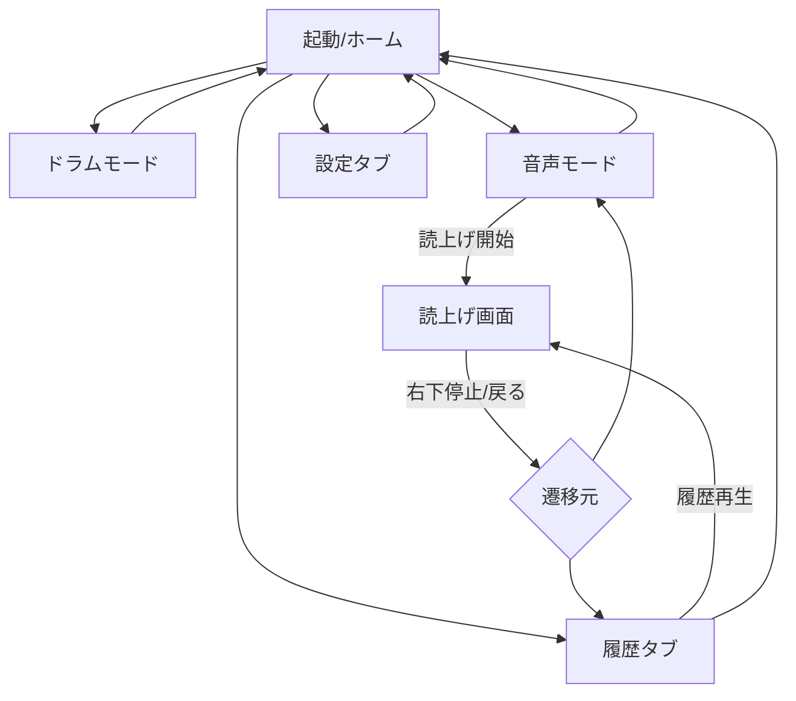

# 01 — UI/UX・画面詳細設計

## 1. ナビゲーション
`AppShell` が上部画面と下部広告スロットを管理する。`HomeTab`、`HistoryTab`、`SettingsTab` を備える。ホームから `Drum`/`VoiceEditor` にpush遷移。`Playback` はその遷移元を保持したフルコンテンツ画面で、タブバーは非表示、**広告スロットは残置**。別のタブ・画面への遷移時に読上げは必ず停止。

## 2. デザインシステム（実装トークン・調整値）

| Token | Color (HEX) | 用途 |
|---|---|---|
| `ink` | `#302C29` | 本文、見出し |
| `primaryOrange` | `#ED8D45` | 最重要アクション、再生 |
| `orangePressed` | `#D8752C` | 押下時 |
| `softOrange` | `#F9E1CD` | 補助カード |
| `warmBeige` | `#EDE1D0` | ドラムページカード |
| `paper` | `#FAF8F4` | 通常背景 |
| `pureWhite` | `#FFFFFF` | 読上げ背景とサーフェス |
| `muted` | `#756F69` | 二次文字 |
| `stroke` | `#DDD7D0` | 境界、区切り |
| `adBackground` | `#F2F0ED` | 広告スロット背景 |

実装前にWCAGコントラストを検査。薄いオレンジに白字を使う大型ボタンは**実測でAA未達なら濃色文字や暗いオレンジ**へ修正し、モックよりアクセシビリティ優先。

- 余白の基準: 4pt; 一般外周 20pt、カード間 16pt、カード内24pt。
- 丸み: メインカード 18pt、ボタン 14pt、小チップ 12pt。
- 影: ごく淡いshadowのみ（必要な場合）。けばけばしい光彩・アニメーション禁止。
- SF Pro/Japanese system font (`.system`)、タイトル `.title2.bold`、本文 `.body`。Dynamic Typeに追随。
- iOSシステムの戻る矢印。色による区別に頼らずアイコン・文言併記。
- タップ可能な最小ヒット領域44x44pt、文字付きボタン高さ≧52pt。
- 読上げ画面だけ背景 `#FFFFFF` を全面に固定。上部ナビ・タブを表示しない。VoiceOverの停止は分かる名前で提供。

## 3. 共通フッター
- UIの唯一の **広告表示枠は AppShell 直下**。各screenが独自にバナーを持ってはならない。
- 未購入時は画面下部のセーフエリア直上にアンカーアダプティブバナー領域を予約。広告サイズはその端末の有効幅で計算し、そのサイズを**全画面で使い回す**。
- タブがある画面: 本文 → タブナビ → 広告枠 → Safe Area。読み上げ画面: 本文 → 広告枠 → Safe Area。
- `adStatus=loading/noFill/consentUnavailable` でも位置は変えず、余白を淡い背景色にする。架空広告や「AD画像ダミー」は描画しない。
- 購入済み: 広告枠（空の余白も含む）を完全除去。
- キーボード表示時: 入力がキーボードで隠れないようSafe Area/scrollとキーボード追従を調整。**キーボード表示中のみ広告領域を非表示**にして入力優先。キーボードを閉じると定位置へ復帰。これは通常の全画面広告位置固定の例外。

## 4. 画面定義

### UI-01 ホーム
**表示:** ナビタイトル `ヘイドラム`、大きな2カード `ドラムモード / シンプルに音を鳴らす` と `音声モード / 文字を読み上げる`。下部タブ `ホーム / 履歴 / 設定`。広告。
**操作:** 各カードタップでpush。戻った際ホーム表示。**飾りの楽器画像は不可**。
**空状態:** 常に2カードあり。

### UI-02 ドラムモード
**表示:** `ドラムモード`、縦並びの大ボタン `ドラム音`（橙）・`金属音`（ベージュ）。補助文 `タップで音を鳴らします`。追加ボタン/エフェクト無し。
**操作:** ボタンのdownまたはtap確定時にサウンド再生（**二重発火禁止**）。連打可。指操作、VoiceOverで各音が識別できる。戻るでホーム。
**表示状態:** 音に反応した100ms程度のpressed styleだけ。リズムアニメーションや波形なし。

### UI-03 音声モード（入力）
**表示:** タイトル `音声モード`、500文字上限の大きな複数行TextEditor、プレースホルダー `読み上げたい文字を入力`、`n/500`、強調ボタン `読み上げ開始`、直近履歴プレビュー最大4件（再生アイコン）、下部広告。スクロールできる。
**入力条件:** 空/空白改行のみなら主ボタン無効。改行・句読点・絵文字を保持。文字数超過ペーストは500文字まで受け付け、簡潔な通知を出してよい。
**操作:** 主ボタンでKeyboard dismiss → 音声再生準備 → 保存と読上げ画面へ。履歴プレビューからの再生は新規履歴生成しない。
**復帰:** 読上げ中止で入力文字列・スクロール位置を維持。

### UI-04 履歴タブ
**表示:** `履歴`、一覧 `lastPlayedAt` 降順、行は本文冒頭1～2行＋時刻＋右側再生ボタン。最大100件。広告は共通。
**操作:** 行タップ/再生ボタン → 読上げ。左スワイプ削除。右上の `すべて削除` は確認ダイアログを要する。
**空表示:** `履歴はまだありません` + `音声モードで読み上げた文章がここに残ります`。500文字の詳細全文は読み上げ画面で確認。
**ルール:** 履歴行を再生すると先頭へ移動、IDは不変。読上げ停止で履歴タブに戻る。

### UI-05 読上げ画面（重点）
**表示:** 純白画面。本文は**発話の進行に合わせて先頭から累積表示**する（開始前・カウントダウン中は本文を表示しない。下線・ハイライト方式は使わない）。文字は左揃え・上寄せで、既に表示した行は動かさず、フォントは再生中に変えない（全文の文字数で決定：〜12字88pt／〜30字72／〜60字60／〜120字52／それ以上46pt。Dynamic Typeで最大2倍まで拡大）。長文は縦スクロールし、追加された最新部分が見えるよう自動で末尾へスクロールする。自然終了時は全文（末尾の句読点含む）を表示したまま残す。
**主制御:** 橙の丸形 72pt（ヒット域十分）。`speaking`なら一時停止アイコン、`paused`なら再生アイコン、`finished`ならリプレイアイコン。`preparing`なら進行状態を表示し連打禁止。
**補助状態:** `読み上げ中` / `一時停止中` / `読み上げが完了しました` を控えめに。
**停止:** **右下、小さなグレーの四角アイコン**。タップ域44x44ptだがアイコンは16〜20pt。発話中は `停止`、終了時は `戻る` とAccessibilityLabel。タブナビ・他のボタンは見せない。
**広告:** **常に画面最下段の共通広告領域**。本文や停止を広告と重ねない。
**遷移:** 手動停止は再生停止→遷移元へ戻る。自然終了時は画面に留まる。再生失敗時は読み上げ画面内エラーと再試行。

### UI-06 設定
**表示:** `設定`、音量スライダー0〜100%（初期70%）、`音声`（選ばれた日本語音声名）、`読み上げ速度`（初期標準付近。MVPは簡単な3段階: ゆっくり/標準/速め）、`音声を試す`、`広告を非表示にする`（購入前のみ）、`購入を復元`、`プライバシー設定`（UMPが要請する場合）、`プライバシーポリシー`、`アプリについて`。広告。
**音声:** 利用可能な日本語ボイスだけ選択可能。声の性別表記は**端末が実際に提供する情報に基づく**。女性確約の誤表示をしない。標準日本語へのfallback必須。
**課金:** 商品取得中は価格欄プレースホルダー。取得後はStoreKit表示価格 `○○円`（実際の値）と `買い切り・広告を削除`。完了後 `広告非表示済み`。復元ボタンは常にアクセス可能。
**音量:** 端末全体の音量ではなく**アプリ内出力の音量**である説明を小さく。

## 5. 縦横・画面密度
- v1はPortrait固定。外周制約付きSwiftUIレイアウト。
- 小型iPhoneで文字の切れ・下部広告との重なりなし。履歴リスト・設定はScrollView/Listで可変。
- 読上げ500文字は複数段落でも全文スクロール可能。累積表示の更新で不自然なスクロールジャンプを生まない。
- 画面収録・スクリーンショットで文章全文が見え得る点は一般的なOS挙動。入力内容の自動ログ送信は行わない。

## 6. モックから意図的に異なる点
モックの文字数 `0/500`、2音、5画面、ベージュ/橙/白は採用。実装では専用履歴タブ、読上げ時のタブ非表示、広告同意状態管理、文字の可読性・実機差への追従を優先する。モック内の見本広告は**実広告SDKコンポーネント**で置き換える。
