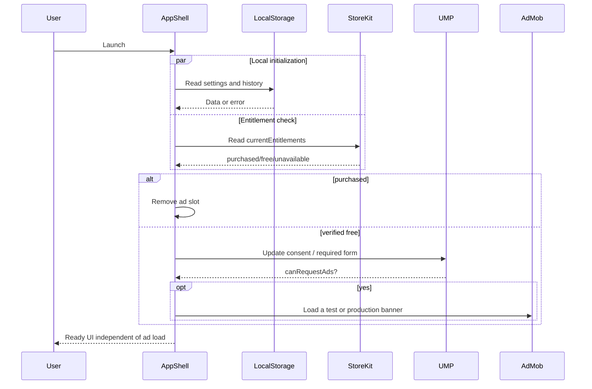
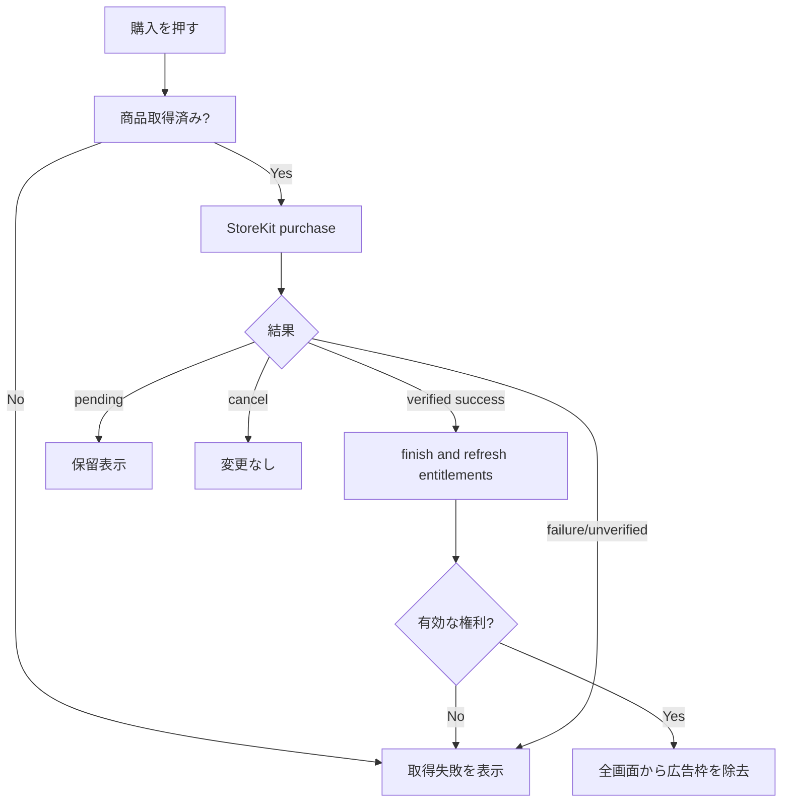

# 03 — ユースケース・処理フロー・シーケンス

## UC-01 アプリ起動
1. `HeyDrumApp` がDIを組み立てる。初期画面はホーム。
2. ローカル設定を読み込み、異常値をデフォルトへ補正する。
3. 効果音2つをpreload、履歴を読み込む。失敗は局所エラー扱い、ホーム起動を妨げない。
4. StoreKit `Transaction.updates` の監視開始 → `Transaction.currentEntitlements` から広告除去権利を検証。
5. 未課金と確認できた場合のみ、必要な広告プライバシー同意フローを進める。`canRequestAds` 等確認後AdMobを初期化/バナーを要求。
6. アプリのルート共通広告領域を表示。購入状態が `checking` 中は広告リクエストせず領域のみ確保。
7. UIの操作は課金/広告/ネットの完了を待たせない。



## UC-02 二音再生
1. `DrumView` で `ドラム音` 又は `金属音` タップ。
2. `SoundService.play(kind, volume: settings.masterVolume)`。
3. 対象音の準備済プールから使用可能プレイヤーを選択し、短時間で音を出す。
4. 他の音ボタンは有効のまま。必要以上の同時音声は上限で抑える。
5. 再生中にアプリを背景化したら全停止。エラー時は控えめなエラーを表示、画面は維持。
6. 履歴へ保存しない。読み上げセッションを触らない。

## UC-03 新規読み上げ
1. TextEditor入力 (`String.count<=500`)。`trimmingCharacters(in:.whitespacesAndNewlines)` が空なら開始不可。
2. `読み上げ開始` でボタンを無効化して二重イベントを防止。原文の先頭末尾空白は**読み上げ/保存時には除去**、内部改行は維持。
3. `SpeechService` の日本語音声存在確認/AVAudioSession準備。存在しなければエラーを入力画面に表示し保存しない。
4. `HistoryRepository.appendNew` で原文保存 (最大100にprune)。**保存成功後** に読上げ画面へ移る。
5. `PlaybackVM` がセッションを新規開始。`AVSpeechUtterance`とパラメータ設定→`AVSpeechSynthesizer.speak`。
6. 読上げ画面に遷移し文字全文を表示。`didStart` で `speaking`、`willSpeakRange` でハイライト更新。
7. `didFinish` で `finished`、その画面に留まる。`もう一度`では同じIDを使い履歴登録を増やさない。
8. `停止` で直ちに読み上げを止め、入力文字列とスクロールを維持した編集画面へ戻る。

**保存失敗の扱い:** ローカル保存失敗時、UIは `履歴を保存できません。空き容量などを確認してください` を表示し、この操作は読み上げを開始しない（履歴確実性優先）。この方針を変える場合は仕様改訂・テスト変更が必要。

```mermaid
sequenceDiagram
 participant U as User
 participant V as VoiceEditorVM
 participant R as HistoryRepository
 participant C as Coordinator
 participant T as SpeechService
 participant P as PlaybackVM
 U->>V: Tap Start
 V->>V: Validate and lock submission
 V->>T: Verify Japanese voice/audio readiness
 alt readiness failed
   T-->>V: Error
   V-->>U: Show error; no history
 else ready
   V->>R: appendNew(text)
   alt write failed
    R-->>V: Error
    V-->>U: Show error; remain editor
   else write succeeded
    R-->>V: Entry
    V->>C: Show playback(origin:editor,entry)
    C->>P: start(entry)
    P->>T: speak(text, sessionID)
    T-->>P: started/range/finished
    P-->>U: Update current text and control
   end
 end
```

## UC-04 履歴再生
1. Historyの行の再生ボタンをタップ。
2. `HistoryRepository.markPlayed(id, at:)` で順序を更新。エラーなら画面に知らせ、再生しない。
3. `Coordinator.openPlayback(origin:.history(id:))`。
4. TTS開始。`完了`でそのまま、`停止`で履歴タブに戻る。
5. **同じIDを維持し、履歴総件数は増えない**。削除や再生直後のリスト更新でもIDが変わらない。

## UC-05 一時停止・再開・停止
- 再生中の中央押下→ `pauseSpeaking(at: .immediate)` → 成功時 `paused`。
- 一時停止中の中央押下→ `continueSpeaking()` → `speaking`。
- 完了時の中央押下→ 新しい`sessionID`で全文を最初から再読。履歴登録はしない。
- 右下停止→ `activeSessionID`破棄 → `stopSpeaking(at: .immediate)` → 広告フッターを残して元画面へpop。二重pop禁止。
- アプリ背景化→音声を停止。再開時に**勝手に再生しない**。背景化が読み上げ画面中なら `finished` 相当の停止状態にし、明示再生のみ受け付ける。

## UC-06 履歴の削除
1. 1件スワイプ→Repository.delete。成功時一覧更新。失敗時エラーメッセージ。
2. `すべて削除`→破壊的ダイアログ `履歴100件以内をすべて削除します。元に戻せません` →確定→ `deleteAll`。
3. 再生中にHistoryを消す動線はv1には存在しない。過去ページ再表示でデータを再取得。

## UC-07 広告除去購入と復元
1. Settingsで「広告を非表示にする」。未課金検証済み・商品情報取得済みの場合のみ押下可能。
2. `Product.purchase()`。
3. `success(.verified(tx))`→productID/revocationを確認→`tx.finish()`→entitlements再読込み→`purchased`。
4. AppShellが即時に広告リクエスト/表示を中止し、バナービューとスロットを除去。再入場しても広告出さない。
5. `.pending` は保留表示し広告は維持（規定の同意がある場合）。`.userCancelled` は変化なし。失敗は再試行可能。
6. 「購入を復元」は **ユーザー操作時にのみ** `AppStore.sync()`、続けてentitlements再検証。復元できなければ丁寧に説明。
7. `Transaction.updates` 監視により、他端末で購入や返金・失効が起きた場合に権利を再評価。返金後は広告に復帰し、同意状態から再検査。



## UC-08 設定変更
1. 音量スライダー操作→ `masterVolume` を0〜1へ丸めて保存。
2. 現在鳴っている効果音にも可能なら即時適用、読み上げ `AVSpeechUtterance.volume` は開始時に設定されるため **読上げ中は音量を変更するUIへ遷移しない**。次の発話から変更反映。
3. 音声候補表示→ `AVSpeechSynthesisVoice.speechVoices()`からja-JP選択を提示。消失時は自動fallback。
4. 試し聴きは短い固定文字 `こんにちは。ヘイドラムです。` を読み上げるが履歴を作らない。設定から離れると停止。
5. 読み上げ速度は3段階。サウンド音程・音色は変更しない。

## UC-09 エラー/オフライン
- 広告失敗は静かにスロット維持、入力/音声は使用可能。
- StoreKit取得失敗は「現在購入情報を取得できません」。読み上げ利用可能。
- 日本語システム音声見つからない場合は読み上げだけ無効にして手順メッセージ表示。ネットへ自動音声送信しない。
- ローカルhistoryファイル破損では `.corrupt` を通知し、元ファイルを保護して自動上書きしない。ユーザー明示の「履歴を初期化」を用意するか復旧案内。
- 音声割込み時は次回タップが正常動作し二重発話しないことを優先。
