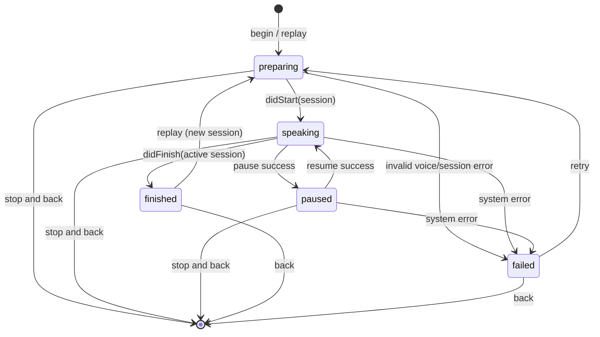
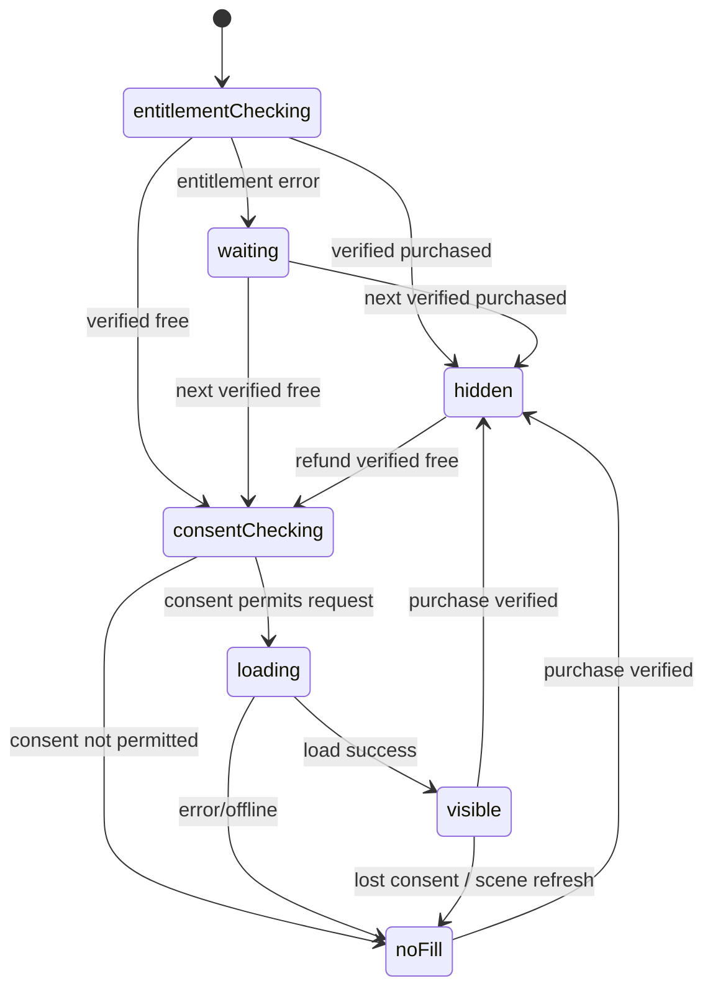

# 07 — 状態遷移・エラー・境界ケース

## 1. 読み上げ状態機械

**イベント対照:** 同一activeSessionIDに属するdelegateイベント以外は無視。`didCancel`は `stop`由来なら状態を勝手に`finished`にしない。

## 2. 広告状態機械

`hidden`は購入済みで広告領域0。`waiting` と`noFill`は通常同じフッター寸法の淡い空領域。`consentChecking`は初回同意画面以外UI操作を妨げない。

## 3. 優先度付エラー一覧
| ID | 状況 | UI動作 | 非同期処理 |
|---|---|---|---|
| ER-01 | 日本語TTS声なし | エラーメッセージ＋設定誘導 | 保存/遷移しない |
| ER-02 | TTS発話失敗 | 読上げ画面でリトライ | Sessionを無効化して再準備 |
| ER-03 | stop後delegate通知 | UI変化なし | stale sessionイベント破棄 |
| ER-04 | 500文字超ペースト | 500まで制限・カウンタ更新 | Repositoryもreject |
| ER-05 | 空白/改行のみ | 読上げボタン非活性 | 処理無し |
| ER-06 | history読込破損 | エラー状態、元ファイル保護 | 自動空データ上書き禁止 |
| ER-07 | 履歴保存容量不足 | メッセージ、入力保持 | 再生開始しない |
| ER-08 | AdMob通信断/no fill | 広告の空スロット維持 | 読上げには影響なし |
| ER-09 | 課金情報ロード不能 | 購入操作不可、復元/再試行 | 発話/効果音は利用可能 |
| ER-10 | IAP `.pending` | 保留と説明 | entitlements監視継続 |
| ER-11 | IAP `.unverified` | 特典解放しない | エラー記録（本文は含めない） |
| ER-12 | 無音（音量0/端末ミュート） | 設定を案内、無理に増幅しない | システム制御尊重 |
| ER-13 | 連打（開始/停止/課金） | 二重処理禁止 | requestID / task guard |
| ER-14 | アプリ背景化・着信 | 停止・自動再開なし | session/プレイヤー解放 |
| ER-15 | 音声ボイスID消失 | ja-JP fallback、必要なら通知 | 保存値を安全に補正 |
| ER-16 | 復元で購入無し | 「復元できる購入が見つかりません」 | 広告状態変化なし |
| ER-17 | 画面サイズ極小 / Dynamic Type特大 | ScrollView内で累積表示（最新部分へ自動スクロール）、広告重なりなし | ボタン最小44pt |
| ER-18 | iOS 26+ UI/SDK差 | ビルド/実機でバナーAPI調整 | ベンダー最新版に追従 |

## 4. テキスト条件
- 文字はSwift `Character` 単位で計数。絵文字結合、サロゲート、改行に対応。
- 不正UTF-16をSwift `String` で直接保持しない。delegate受信範囲はFoundation変換検証。
- セキュリティ: JSONへ保存した文字列をHTMLとしてrenderしない、URLとして実行しない。アプリ内ではプレーンテキスト。
- 過剰改行500文字や極端に長い単語でUIが破綻しないよう折返し/スクロール。

## 5. 保存・課金の整合性
- 同時のRepository操作はactor直列化。
- UI起動時広告フラグが未判定なら**広告SDK呼出しを遅延**。
- 設定中に購入確認が遅延しても複数購入要求を発火しない。
- ローカル履歴は購入状態とは無関係。
- 有効権利不明時に「購入されていない」と断定しない。
