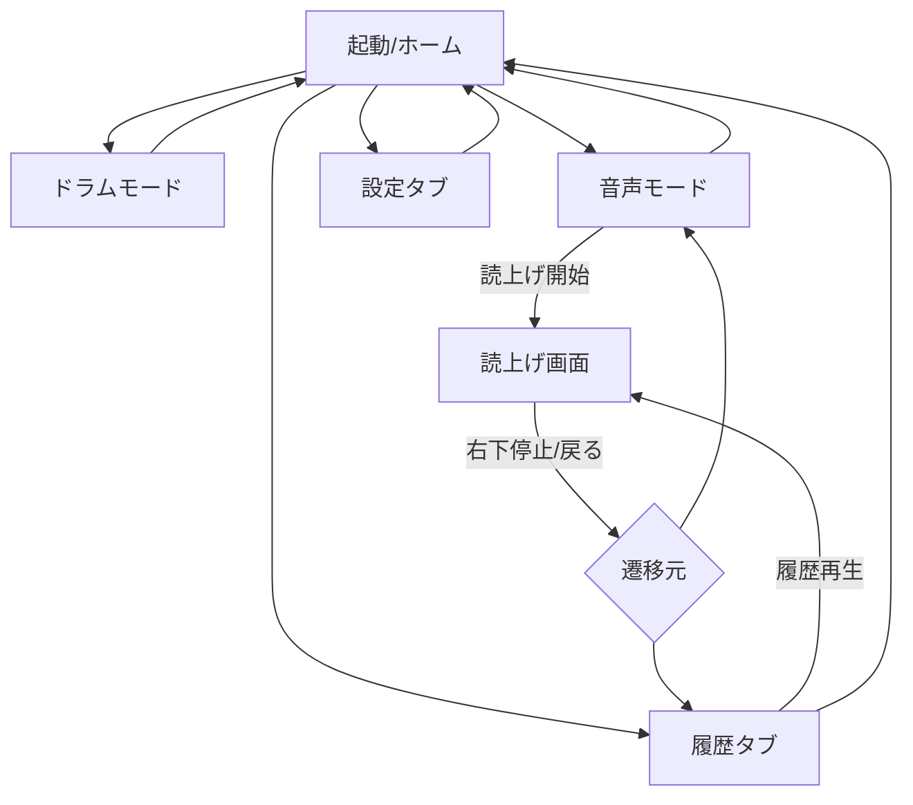
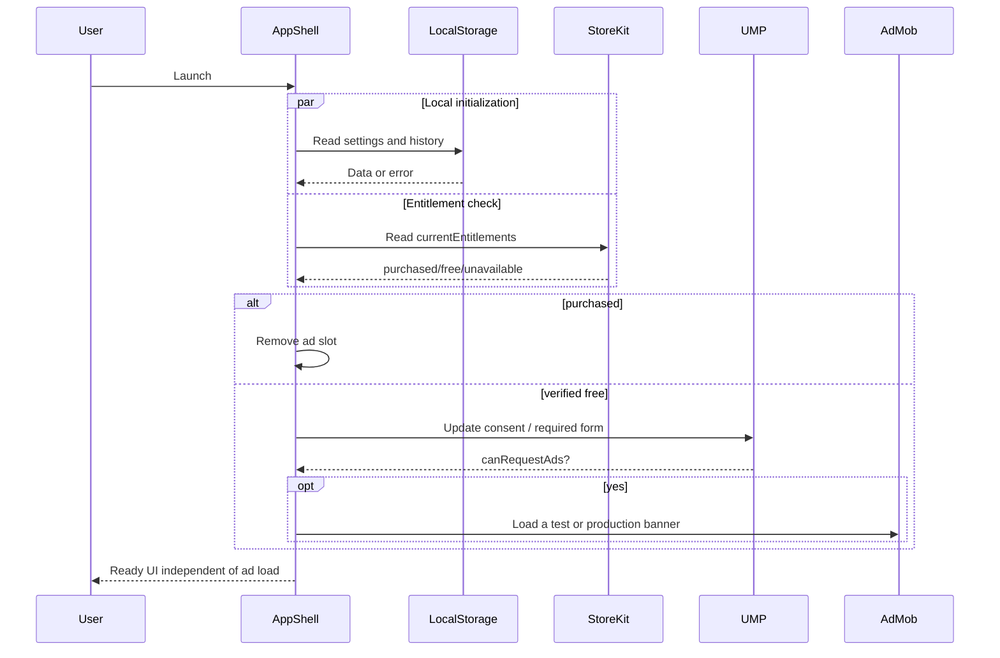
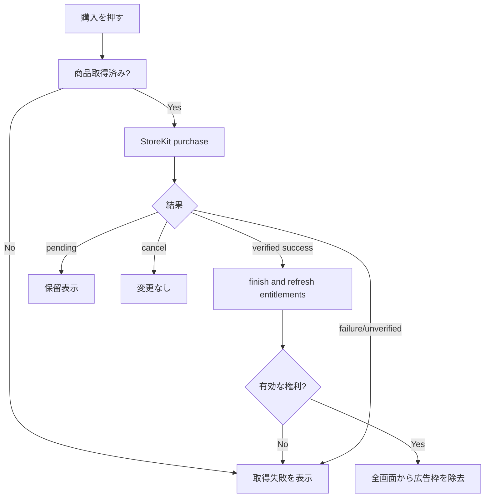
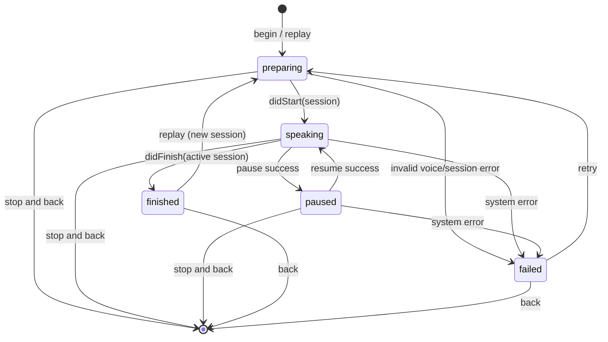
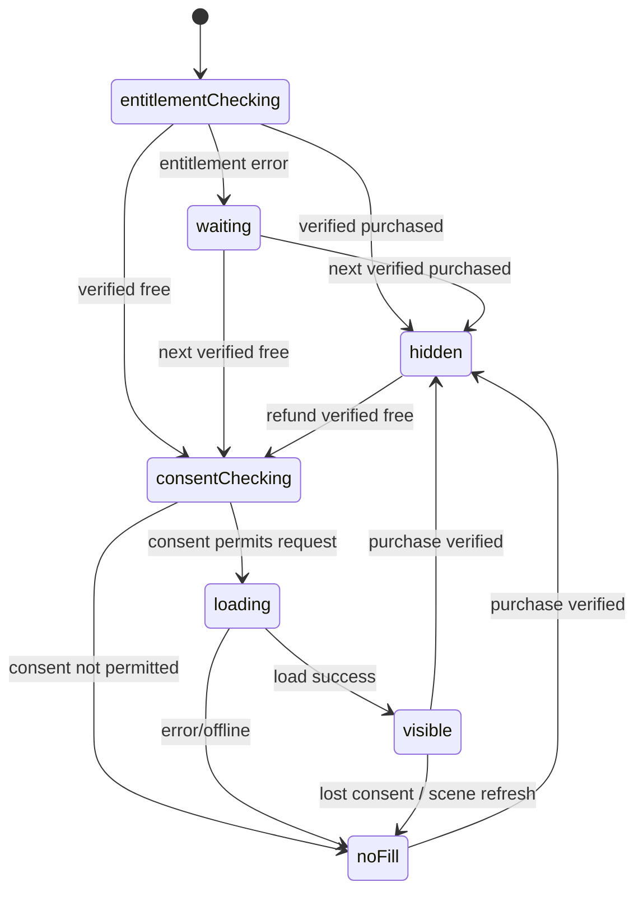

# ヘイドラム — 統合実装仕様書 v1.0

**正本**: 各 `docs/` ファイル。本文は添付しやすいよう複製した統合版です。

# ヘイドラム — iPhoneアプリ設計パッケージ v1.0

作成日: 2026-10-19 / ステータス: 実装開始可能（外部ID・購入価格・音声実機試聴のみ保留）

## このパッケージの使い方

**実装担当 Claude:** 最初に `CLAUDE.md` → `docs/00_REQUIREMENTS.md` → `docs/01_UX_SCREEN_SPEC.md` → `docs/02_TECH_ARCHITECTURE.md` → `docs/03_INTERACTION_FLOW.md` → 個別設計 → `docs/09_TEST_PLAN.md` の順に読む。`prompts/CLAUDE_IMPLEMENT.md` を初回指示として使う。

**独立レビュー担当 Codex:** `prompts/CODEX_REVIEW.md` に従う。要求仕様やテストを勝手に都合よく書き換えない。

**所有者:** App Store ConnectのApp ID、商品ID、課金価格、AdMobの実ID、プライバシーポリシーURLを自分のアカウントで発行。すべて未確定のものはプレースホルダーとして扱う。

## 一覧

| ファイル | 用途 |
|---|---|
| `reference/HeyDrum_UI_Mockup.png` | 画面・配色の初期ビジュアル（仕様との相違は文書が優先） |
| `docs/00_REQUIREMENTS.md` | プロダクト要求、確定値、非機能、スコープ、受入条件 |
| `docs/01_UX_SCREEN_SPEC.md` | 各画面の要素、操作、画面遷移、デザインシステム |
| `docs/02_TECH_ARCHITECTURE.md` | アーキテクチャ、Swift型、責務、ファイル構成、依存性 |
| `docs/03_INTERACTION_FLOW.md` | 起動・打音・読み上げ・履歴・停止・課金などの処理フロー |
| `docs/04_SPEECH_AUDIO.md` | Apple内蔵音声合成、音声状態、音源、音量・割込み |
| `docs/05_LOCAL_DATA.md` | ローカル履歴100件、設定保存、データ保持 |
| `docs/06_ADS_PURCHASES_PRIVACY.md` | 広告、買い切り課金、復元、同意、プライバシー |
| `docs/07_STATES_AND_ERRORS.md` | 状態遷移図、失敗・境界条件、フェイルセーフ |
| `docs/08_IOS_PROJECT_SETUP.md` | Xcode作成・SPM・Info.plist・配置・ビルド設定 |
| `docs/09_TEST_PLAN.md` | 単体・統合・UI・実機・回帰・出荷条件 |
| `docs/10_WORK_PLAN.md` | Claude実装順、フェーズごとの完成条件、Codexゲート |
| `docs/11_RELEASE_CHECKLIST.md` | App Store公開前の確認と未確定事項 |
| `docs/12_TRACEABILITY.md` | 要件→実装→テスト→レビューの対応 |
| `docs/13_SOURCES.md` | Apple/Google公式ドキュメントの参照URL |
| `CLAUDE.md` | リポジトリ上の実装ルール（Claude向け） |
| `prompts/CLAUDE_IMPLEMENT.md` | Claudeへの初回依頼文 |
| `prompts/CODEX_REVIEW.md` | Codexレビュー依頼文・報告フォーマット |
| `assets/drum.wav`, `assets/metal.wav` | 本パッケージで合成したオリジナル効果音（外部音源不使用） |

## 決定事項の優先順位

1. ユーザーが明示した要求（アプリ名、2音、非AI TTS、履歴100件、読上げ時の白、固定位置広告など）
2. 本パッケージの `00_REQUIREMENTS.md` と他の個別設計（矛盾があれば `00` の採用要件が優先）
3. UIモックアップ（形・余白・色の参照。画面の挙動は設計書が優先）
4. 実装者の判断（変更は `docs/DECISIONS_LOG.md` に追記）

## 注意

- **「AI不使用」**とは、外部AIサービス・生成AI API・独自モデル推論を利用しない実装を指す。Apple標準音声合成の内部アルゴリズムまでは保証しない。
- **声の女性らしさ**と**完全オフライン発話可否**はOS・端末・インストール済み声に依存。実機受入テスト必須。
- バナー広告は **無課金・同意要件クリア時** に表示。課金済みなら全画面で広告スロットごと削除。
- 設計・音源は用意したが、Xcodeアプリはこのパッケージでは**まだ実装していない**。


---

# 00 — 要件定義 / PRD

## 0. メタ情報
- 正式日本語名: **ヘイドラム** （UI表示・App Store表示名。変更禁止）
- 内部英語作業名: HeyDrum（コード・ファイル名のみ。正式ブランドの英字表記は未承認）
- 種別: iPhone専用・縦画面・日本語UI・無料（広告あり） + 広告除去買い切り
- 技術責任: Claude = 実装、Codex = 独立レビュー、最終受入 = オーナー
- OS: iOS 17.0以上を実装基準とする仮決定。配布直前に利用対象・SDK条件を確認。
- ビルド: Swift、SwiftUI、AVFoundation、StoreKit 2、Google Mobile Ads SDK/UMP。
- バックエンド: 不要。ログイン・アカウント・同期なし。音声文字列をサーバーへ送信しない。

## 1. コンセプト
「二つの音を鳴らす」「文字を読み上げる」だけの、一瞬で理解できる道具。視覚に**ドラム・楽器・AI・ロボットのモチーフを使わない**。添付人物の服のベージュ／オレンジ／白を抽象的な配色として用いる。読み上げ中は白い余白を主役にする。

## 2. 機能要件（MUST）

| ID | 機能 | 受入基準 |
|---|---|---|
| FR-001 | ホーム画面 | ドラムモード、音声モードの二択が常時視認可能 |
| FR-002 | ドラムモード | **2つだけ**の音ボタン（「ドラム音」「金属音」）。タップ直後に対応音が1回鳴る |
| FR-003 | 外観 | 楽器写真、スティック、波形、AI風発光やロボットイラストなし |
| FR-004 | 音声入力 | 日本語を中心とした任意テキスト0〜500文字。空白だけは再生不可 |
| FR-005 | 音声合成 | Apple標準 `AVSpeechSynthesizer` で発話。外部AI API、クラウドTTSなし |
| FR-006 | 声質 | 日本語の女性的・やや機械的な声を**目標**とし、利用可能ボイスから選択。端末依存を明示 |
| FR-007 | 読上げ画面 | 再生開始で専用画面に切替。白基調。文字を大きく表示。中央に明確な再生/一時停止/再開ボタン |
| FR-008 | 読上げ停止 | 右下の小さく控えめな「停止」で、発話を完全停止し**直前の画面へ戻る** |
| FR-009 | 履歴保存 | 発話開始が成功した入力文字列をローカル記録。最大100件。永続化 |
| FR-010 | 履歴再生 | 履歴行の再生ボタンで直接読上げ画面へ遷移し再生できる |
| FR-011 | 履歴上限 | 101件目保存時に最も古い未使用順の1件を削除。常に件数≦100 |
| FR-012 | 共通広告 | 未購入時、ホーム/ドラム/音声/履歴/読上げ/設定で同一フッター位置に広告領域 |
| FR-013 | 広告除去 | 設定からAppleの**非消耗型IAP**で買い切り。購入を検証し全画面の広告枠を隠す |
| FR-014 | 購入復元 | 設定に「購入を復元」。別端末・再インストールで購入権利を反映 |
| FR-015 | 音量 | 設定でマスター音量0〜100%を調整。2効果音と読み上げに即時/次回適用 |
| FR-016 | オフライン基本機能 | 効果音と保存履歴はネットワーク不要。音声は端末の利用可能な日本語システム音声で動作する設計、機内モード実機確認 |
| FR-017 | 日本語 | UI、アクセシビリティ文言、エラー文言を日本語に統一 |
| FR-018 | 画面の保存 | 入力を保持し、停止から戻って編集し直せる。履歴遷移元へ戻れる |

## 3. MVP実装上の確定補足（元要求を具体化）
- 読上げ文字数上限 **500 grapheme clusters**（Swift `String.count`）。UI上は `n/500`。
- ホームタブ・履歴タブ・設定タブ。ホーム内から2つのモードへ遷移。読上げ画面はタブを隠すが**広告フッターは残す**。
- 既存履歴を再生しても重複追加しない。履歴の `lastPlayedAt` を更新して先頭へ移動。
- 同じテキストを音声入力から新規再生した場合は、文字列が同じでも別履歴として追加する（明示操作を残す）。
- 読上げ自然終了後は読上げ画面に残り、中央ボタンを「もう一度」に変える。右下は「戻る」相当の機能として動く（ラベルは終了状態に応じて切替）。
- 読上げ画面の中央ボタンは進行中 = 一時停止、一時停止中 = 再開、終了 = もう一度。誤タップでも履歴を重複作成しない。
- 音量0%時も操作は成立するがミュート。システム音量・Bluetooth出力音量とは別。
- 入力エリアを編集しただけでは履歴に保存しない。
- 履歴削除は個別削除・全削除確認ダイアログを用意。
- 手動で過去履歴を削除しても課金状態は消えない。アプリ削除でローカル履歴は失われる。
- アプリはフォアグラウンドのみで再生。バックグラウンド移行で音声・効果音を止める。バックグラウンドオーディオ権限不要。

## 4. 非機能要件
| ID | 基準 |
|---|---|
| NFR-001 | ネイティブSwiftUI。起動時に利用規約などの不要な強制画面を出さない（法令上必要な広告同意は例外） |
| NFR-002 | 2音の再生準備を起動時に済ませ、タップ体感遅延を小さくする。主要UI操作はメインスレッドを塞がない |
| NFR-003 | ローカルデータをクラッシュしてもできる限り保護。保存失敗は明示し、上書きで静かに消さない |
| NFR-004 | VoiceOver・Dynamic Type・44pt相当タップ領域・十分な文字コントラストを考慮 |
| NFR-005 | 課金権利・広告同意確定前には広告リクエストしない。広告失敗でも音声等に影響させない |
| NFR-006 | iPhone SE相当の狭幅から大型iPhoneまで崩れない、縦画面 |
| NFR-007 | 音声文字列を解析・トラッキング・ログ送信しない。クラッシュログや分析SDKも初期搭載しない |
| NFR-008 | 音声の再生とボタン状態は一意に管理し、二重再生・非同期コールバック競合を避ける |
| NFR-009 | 無料の音声合成APIのみ。外部TTS利用料、サーバー費用なし（広告/Apple手数料は別） |
| NFR-010 | 2つのローカル音源は本パッケージの自作WAVを同梱し、外部音源のライセンス依存なし |

## 5. 明確なスコープ外（v1）
音声データの保存・共有、録音、音声認識、AI、チャット、音声変更の多量プリセット、BGM、リズム打ち、複数効果音、SNS、バックアップ同期、ログイン、通知、サブスクリプション、iPad専用UI、Android、ウィジェット、多言語UI、バックグラウンド読み上げ。

## 6. 要決定（実装は設定値を仮置きして着手可能）
| 保留 | デフォルト実装方針 |
|---|---|
| Bundle Identifier | Xcodeで所有者の識別子を設定、テンプレートに実値を書かない |
| IAP Product ID | `YOUR_BUNDLE_ID.remove_ads` を**仮の論理例**として説明。実アカウントで確定・設定 |
| 買い切り価格 | 設定画面では StoreKit が返す `Product.displayPrice` を表示。金額をハードコードしない |
| AdMob App ID・Banner Unit ID | `Secrets/` や build config 経由で導入。公開前に実値設定、コードへ直書きしない |
| 音声の声質 | `ja-JP` 利用可能音声を実機試聴し優先voice.identifierを設定。fallbackはシステム標準日本語 |
| プライバシーポリシーURL | 配布前必須。内容にAdMob/UMP/StoreKitの実際の運用を反映 |

## 7. 完成とみなす条件
全FR、主要NFR、`09_TEST_PLAN.md` P0が通過し、実機で日本語TTS・2効果音・広告フッター固定・課金復元の確認結果が残り、CodexがP0/P1の未解決指摘なしと判断した段階。実アカウント連携なしのビルドは**実装完成候補**であって公開準備完了ではない。


---

# 01 — UI/UX・画面詳細設計

## 1. ナビゲーション
`AppShell` が上部画面と下部広告スロットを管理する。`HomeTab`、`HistoryTab`、`SettingsTab` を備える。ホームから `Drum`/`VoiceEditor` にpush遷移。`Playback` はその遷移元を保持したフルコンテンツ画面で、タブバーは非表示、**広告スロットは残置**。別のタブ・画面への遷移時に読上げは必ず停止。



## 2. デザインシステム（実装トークン・調整値）

| Token | Color (HEX) | 用途 |
|---|---|---|
| `ink` | `#302C29` | 本文、見出し |
| `primaryOrange` | `#ED8D45` | 最重要アクション、再生 |
| `orangePressed` | `#D8752C` | 押下時 |
| `softOrange` | `#F9E1CD` | 補助カード |
| `warmBeige` | `#EDE1D0` | ドラムページカード |
| `paper` | `#FAF8F4` | 通常背景 |
| `pureWhite` | `#FFFFFF` | 読上げ背景とサーフェス |
| `muted` | `#756F69` | 二次文字 |
| `stroke` | `#DDD7D0` | 境界、区切り |
| `adBackground` | `#F2F0ED` | 広告スロット背景 |

実装前にWCAGコントラストを検査。薄いオレンジに白字を使う大型ボタンは**実測でAA未達なら濃色文字や暗いオレンジ**へ修正し、モックよりアクセシビリティ優先。

- 余白の基準: 4pt; 一般外周 20pt、カード間 16pt、カード内24pt。
- 丸み: メインカード 18pt、ボタン 14pt、小チップ 12pt。
- 影: ごく淡いshadowのみ（必要な場合）。けばけばしい光彩・アニメーション禁止。
- SF Pro/Japanese system font (`.system`)、タイトル `.title2.bold`、本文 `.body`。Dynamic Typeに追随。
- iOSシステムの戻る矢印。色による区別に頼らずアイコン・文言併記。
- タップ可能な最小ヒット領域44x44pt、文字付きボタン高さ≧52pt。
- 読上げ画面だけ背景 `#FFFFFF` を全面に固定。上部ナビ・タブを表示しない。VoiceOverの停止は分かる名前で提供。

## 3. 共通フッター
- UIの唯一の **広告表示枠は AppShell 直下**。各screenが独自にバナーを持ってはならない。
- 未購入時は画面下部のセーフエリア直上にアンカーアダプティブバナー領域を予約。広告サイズはその端末の有効幅で計算し、そのサイズを**全画面で使い回す**。
- タブがある画面: 本文 → タブナビ → 広告枠 → Safe Area。読み上げ画面: 本文 → 広告枠 → Safe Area。
- `adStatus=loading/noFill/consentUnavailable` でも位置は変えず、余白を淡い背景色にする。架空広告や「AD画像ダミー」は描画しない。
- 購入済み: 広告枠（空の余白も含む）を完全除去。
- キーボード表示時: 入力がキーボードで隠れないようSafe Area/scrollとキーボード追従を調整。**キーボード表示中のみ広告領域を非表示**にして入力優先。キーボードを閉じると定位置へ復帰。これは通常の全画面広告位置固定の例外。

## 4. 画面定義

### UI-01 ホーム
**表示:** ナビタイトル `ヘイドラム`、大きな2カード `ドラムモード / シンプルに音を鳴らす` と `音声モード / 文字を読み上げる`。下部タブ `ホーム / 履歴 / 設定`。広告。
**操作:** 各カードタップでpush。戻った際ホーム表示。**飾りの楽器画像は不可**。
**空状態:** 常に2カードあり。

### UI-02 ドラムモード
**表示:** `ドラムモード`、縦並びの大ボタン `ドラム音`（橙）・`金属音`（ベージュ）。補助文 `タップで音を鳴らします`。追加ボタン/エフェクト無し。
**操作:** ボタンのdownまたはtap確定時にサウンド再生（**二重発火禁止**）。連打可。指操作、VoiceOverで各音が識別できる。戻るでホーム。
**表示状態:** 音に反応した100ms程度のpressed styleだけ。リズムアニメーションや波形なし。

### UI-03 音声モード（入力）
**表示:** タイトル `音声モード`、500文字上限の大きな複数行TextEditor、プレースホルダー `読み上げたい文字を入力`、`n/500`、強調ボタン `読み上げ開始`、直近履歴プレビュー最大4件（再生アイコン）、下部広告。スクロールできる。
**入力条件:** 空/空白改行のみなら主ボタン無効。改行・句読点・絵文字を保持。文字数超過ペーストは500文字まで受け付け、簡潔な通知を出してよい。
**操作:** 主ボタンでKeyboard dismiss → 音声再生準備 → 保存と読上げ画面へ。履歴プレビューからの再生は新規履歴生成しない。
**復帰:** 読上げ中止で入力文字列・スクロール位置を維持。

### UI-04 履歴タブ
**表示:** `履歴`、一覧 `lastPlayedAt` 降順、行は本文冒頭1～2行＋時刻＋右側再生ボタン。最大100件。広告は共通。
**操作:** 行タップ/再生ボタン → 読上げ。左スワイプ削除。右上の `すべて削除` は確認ダイアログを要する。
**空表示:** `履歴はまだありません` + `音声モードで読み上げた文章がここに残ります`。500文字の詳細全文は読み上げ画面で確認。
**ルール:** 履歴行を再生すると先頭へ移動、IDは不変。読上げ停止で履歴タブに戻る。

### UI-05 読上げ画面（重点）
**表示:** 純白画面。本文を中央または縦中央より少し上に大きくレイアウト（例 `.title2`〜`.largeTitle`）。長文は縦スクロールし、読み上げ箇所をアクセントで軽く強調できる。文字全文は削らない。
**主制御:** 橙の丸形 72pt（ヒット域十分）。`speaking`なら一時停止アイコン、`paused`なら再生アイコン、`finished`ならリプレイアイコン。`preparing`なら進行状態を表示し連打禁止。
**補助状態:** `読み上げ中` / `一時停止中` / `読み上げが完了しました` を控えめに。
**停止:** **右下、小さなグレーの四角アイコン**。タップ域44x44ptだがアイコンは16〜20pt。発話中は `停止`、終了時は `戻る` とAccessibilityLabel。タブナビ・他のボタンは見せない。
**広告:** **常に画面最下段の共通広告領域**。本文や停止を広告と重ねない。
**遷移:** 手動停止は再生停止→遷移元へ戻る。自然終了時は画面に留まる。再生失敗時は読み上げ画面内エラーと再試行。

### UI-06 設定
**表示:** `設定`、音量スライダー0〜100%（初期70%）、`音声`（選ばれた日本語音声名）、`読み上げ速度`（初期標準付近。MVPは簡単な3段階: ゆっくり/標準/速め）、`音声を試す`、`広告を非表示にする`（購入前のみ）、`購入を復元`、`プライバシー設定`（UMPが要請する場合）、`プライバシーポリシー`、`アプリについて`。広告。
**音声:** 利用可能な日本語ボイスだけ選択可能。声の性別表記は**端末が実際に提供する情報に基づく**。女性確約の誤表示をしない。標準日本語へのfallback必須。
**課金:** 商品取得中は価格欄プレースホルダー。取得後はStoreKit表示価格 `○○円`（実際の値）と `買い切り・広告を削除`。完了後 `広告非表示済み`。復元ボタンは常にアクセス可能。
**音量:** 端末全体の音量ではなく**アプリ内出力の音量**である説明を小さく。

## 5. 縦横・画面密度
- v1はPortrait固定。外周制約付きSwiftUIレイアウト。
- 小型iPhoneで文字の切れ・下部広告との重なりなし。履歴リスト・設定はScrollView/Listで可変。
- 読上げ500文字は複数段落でも全文スクロール可能。TTSハイライト更新で不自然なスクロールジャンプを生まない。
- 画面収録・スクリーンショットで文章全文が見え得る点は一般的なOS挙動。入力内容の自動ログ送信は行わない。

## 6. モックから意図的に異なる点
モックの文字数 `0/500`、2音、5画面、ベージュ/橙/白は採用。実装では専用履歴タブ、読上げ時のタブ非表示、広告同意状態管理、文字の可読性・実機差への追従を優先する。モック内の見本広告は**実広告SDKコンポーネント**で置き換える。


---

# 02 — Swift実装アーキテクチャ・インターフェース詳細

## 1. 採用方式
SwiftUI + MVVM（過剰なClean Architectureを作らない）。`@MainActor @Observable` ViewModel/Coordinator、Repository protocolによるローカル永続化、Audio/StoreKit/AdMobは薄いServiceラッパー。依存注入でユニットテスト可。Swift Concurrencyを採用し、コールバックはMainActorに正規化する。

**使用フレームワーク:** SwiftUI、Observation、AVFAudio/AVFoundation、StoreKit、Foundation、GoogleMobileAds、UserMessagingPlatform。読み上げに `Speech` フレームワーク（音声認識）は使用しない。外部ネットワークは広告・IAP・同意・ポリシーWebリンク以外禁止。

**基本構成:** 
```text
HeyDrum/
├── HeyDrumApp.swift                     // entry; dependency composition
├── App/
│   ├── AppCoordinator.swift             // route and origin, lifecycle
│   ├── AppShellView.swift               // shared screen + fixed ad slot
│   ├── AppConfig.swift                  // identifiers via build config
│   └── AppDependencies.swift            // injection container
├── Design/
│   ├── Theme.swift                      // color and typography tokens
│   ├── PrimaryButton.swift
│   ├── SectionCard.swift
│   └── AdSlotView.swift
├── Features/
│   ├── Home/HomeView.swift
│   ├── Drum/DrumView.swift
│   ├── Voice/VoiceEditorView.swift
│   ├── Voice/VoiceEditorViewModel.swift
│   ├── Voice/PlaybackView.swift
│   ├── Voice/PlaybackViewModel.swift
│   ├── History/HistoryView.swift
│   ├── History/HistoryViewModel.swift
│   └── Settings/SettingsView.swift
├── Domain/
│   ├── Models/HistoryEntry.swift
│   ├── Models/PlaybackState.swift
│   ├── Models/AppSettings.swift
│   ├── Ports/HistoryRepository.swift
│   ├── Ports/SpeechProviding.swift
│   ├── Ports/SoundProviding.swift
│   └── Ports/PurchaseProviding.swift
├── Infrastructure/
│   ├── Audio/SystemSpeechService.swift
│   ├── Audio/DrumSoundService.swift
│   ├── Storage/JSONHistoryRepository.swift
│   ├── Storage/SettingsStore.swift
│   ├── Purchase/StoreKitPurchaseService.swift
│   └── Ads/AdMobManager.swift
├── Resources/
│   ├── Sounds/drum.wav
│   ├── Sounds/metal.wav
│   ├── Localizable.xcstrings
│   └── PrivacyInfo.xcprivacy (必要なAPI使用判定後)
└── Tests/
    ├── Unit/
    ├── Integration/
    ├── UI/
    └── Fixtures/
```
`Info.plist` は Xcode設定自動生成でも可。`Secrets` はGit管理しない。テストターゲットのパスは実際のXcode構造に調整。

## 2. Domainモデル
```swift
struct HistoryEntry: Identifiable, Codable, Equatable, Sendable {
    let id: UUID
    let text: String
    let createdAt: Date
    var lastPlayedAt: Date
}

struct AppSettings: Codable, Equatable, Sendable {
    var masterVolume: Float = 0.70  // 0...1
    var speechSpeed: SpeechSpeed = .normal
    var preferredVoiceIdentifier: String? = nil
}

enum SpeechSpeed: String, Codable, CaseIterable, Sendable {
    case slow, normal, fast
}

enum PlaybackState: Equatable {
    case idle
    case preparing
    case speaking
    case paused
    case finished
    case failed(String)
}

enum PlaybackOrigin: Equatable {
    case editor
    case history
}
```
Swiftのモデルは例。`Date`同値時は `id.uuidString` で決定的ソート。不正文字列・過大サイズをRepositoryで再検査。

## 3. Portインターフェース（実装を誘導する契約）
```swift
@MainActor
protocol SpeechProviding: AnyObject {
    var events: AsyncStream<SpeechEvent> { get }
    func availableJapaneseVoices() -> [SpeechVoiceOption]
    func speak(sessionID: UUID, text: String, voiceID: String?,
               volume: Float, speed: SpeechSpeed) throws
    func pause() -> Bool
    func resume() -> Bool
    func stop()
}

struct SpeechVoiceOption: Identifiable, Equatable, Sendable {
    let id: String               // AVSpeechSynthesisVoice.identifier
    let displayName: String
}

enum SpeechEvent: Sendable {
    case started(sessionID: UUID)
    case range(sessionID: UUID, location: Int, length: Int)  // UTF16 range
    case paused(sessionID: UUID)
    case resumed(sessionID: UUID)
    case finished(sessionID: UUID)
    case cancelled(sessionID: UUID)
    case failed(sessionID: UUID, message: String)
}

@MainActor
protocol SoundProviding: AnyObject {
    func preload() throws
    func play(_ sound: SoundKind, volume: Float)
    func stopAll()
}

enum SoundKind { case drum, metal }

protocol HistoryRepository: Sendable {
    func list() async throws -> [HistoryEntry]
    func appendNew(text: String, at: Date) async throws -> HistoryEntry
    func markPlayed(id: UUID, at: Date) async throws
    func delete(id: UUID) async throws
    func deleteAll() async throws
}

@MainActor
protocol PurchaseProviding: AnyObject {
    var entitlement: EntitlementState { get }
    func startObservingTransactions()
    func refreshEntitlements() async
    func loadProduct() async
    func purchaseRemoveAds() async -> PurchaseOutcome
    func restore() async throws
}

enum EntitlementState { case checking, free, purchased, unavailable }
enum PurchaseOutcome { case purchased, pending, cancelled, failed(String) }
```
**実装時の重要修正ポイント:** `AsyncStream` を `var events` で複数取得しても競合が起こらないよう、単一コンシューマを明確化（Sessionごとの `AsyncStream` を返す方式でもよい）。`SpeechEvent.sessionID` は `speak(sessionID:...)` に渡した `sessionID` と一致させる。AVSpeechSynthesizerのdelegateイベントは古いsessionを捨てる。

## 4. 画面Coordinator契約
```swift
enum AppTab { case home, history, settings }
enum AppRoute: Equatable {
    case home
    case drum
    case voiceEditor
    case history
    case settings
    case playback(text: String, source: PlaybackSource)
}
enum PlaybackSource: Equatable {
    case editor
    case history(id: UUID)
}
```
SwiftUI `NavigationStack(path:)` + root tab selection を使用。`PlaybackView` を広告フッターの**上**へ描画。戻るの処理はCoordinatorが担当し、再生セッション終了→前画面に復帰。history replay からの元画面への復帰は必ずhistoryにする。遷移操作の2重タップを防止。

## 5. 責務境界
- **View:** 画面の見た目とユーザー入力、アクセシビリティ。`AVSpeechSynthesizer` を直接作らない。
- **VoiceEditorVM:** 入力500文字制限、空欄検証、開始要求。現在の草稿を保持。
- **PlaybackVM:** 再生状態機械、中央ボタン動作、ハイライト位置、停止時Coordinator通知。sessionID管理。
- **HistoryVM:** 最新100件の取得/削除/更新、保存成否表示。読み上げ詳細はCoordinatorへ渡す。
- **SystemSpeechService:** 1インスタンスのAVSpeechSynthesizer、delegate、音声選択、stop/pause/resume実処理。
- **DrumSoundService:** `AVAudioPlayer`プールとバンドルWAV。音量は単一設定から取得。
- **HistoryRepository:** 日付/ID保持、最大100の原子的保存・CRUD。画面依存なし。
- **StoreKitPurchaseService:** StoreKit2検証・transactions更新・復元。`UserDefaults.purchased=true`を権利判定に使わない。
- **AdMobManager:** 同意確定後の広告ロードとバナー寿命、 entitlementに基づく一括非表示。ユーザー文字列を広告リクエストに渡さない。
- **SettingsStore:** UserDefaults/AppStorageの設定とバリデーション。課金と履歴の正本にはしない。

## 6. DI / テストダブル
`AppDependencies.live` で全依存を1箇所で生成する。`Preview` とテストには `FakeSpeechService`, `FakeSoundService`, `InMemoryHistoryRepository`, `FakePurchaseService`, `FakeAdProvider` を注入。

テストダブルでは音声delegate相当の `.started` `.finished` `.cancelled` `.range` を任意順で送れること。広告の読み込みの成否も任意に切り替えられること。起動、購入完了後の広告スロット除去、音声停止による復帰を外部SDK無しでテストする。

## 7. 競合制御
- 音声再生セッションはアプリで**常に最大1つ**。`activeSessionID` と送信イベントIDで識別。
- 手動停止では `activeSessionID` を無効化した上で `stopSpeaking(at: .immediate)`。古い `didCancel` で新画面に遷移しない。
- 発話完了イベントはユーザーが停止中・背景移行中なら無視。
- 履歴登録は1回の新規再生につき1回。連打/再試行時の二重登録防止は `requestID` で管理。
- IAP更新は全画面共通の購入状態ストアをmain actorから発行し、古い広告を確実に破棄。

## 8. 軽量化と禁止事項
- v1ではFirebase、Realm、CloudKit、Combine大規模設計、第三者TTS、定期fetch、リモートConfig、独自バックエンドは禁止。
- StoreKit権利判定をmock値のまま出荷しない。
- ソースで `fatalError` により通常の不具合をクラッシュさせない。デバッグ専用assertに留める。
- ObservableObjectとObservationを混在させない。新規プロジェクトはObservation主体とする。
- ユーザー読み上げテキストを `print`, analytics, error reporting, AdMob extras 等に渡さない。


---

# 03 — ユースケース・処理フロー・シーケンス

## UC-01 アプリ起動
1. `HeyDrumApp` がDIを組み立てる。初期画面はホーム。
2. ローカル設定を読み込み、異常値をデフォルトへ補正する。
3. 効果音2つをpreload、履歴を読み込む。失敗は局所エラー扱い、ホーム起動を妨げない。
4. StoreKit `Transaction.updates` の監視開始 → `Transaction.currentEntitlements` から広告除去権利を検証。
5. 未課金と確認できた場合のみ、必要な広告プライバシー同意フローを進める。`canRequestAds` 等確認後AdMobを初期化/バナーを要求。
6. アプリのルート共通広告領域を表示。購入状態が `checking` 中は広告リクエストせず領域のみ確保。
7. UIの操作は課金/広告/ネットの完了を待たせない。



## UC-02 二音再生
1. `DrumView` で `ドラム音` 又は `金属音` タップ。
2. `SoundService.play(kind, volume: settings.masterVolume)`。
3. 対象音の準備済プールから使用可能プレイヤーを選択し、短時間で音を出す。
4. 他の音ボタンは有効のまま。必要以上の同時音声は上限で抑える。
5. 再生中にアプリを背景化したら全停止。エラー時は控えめなエラーを表示、画面は維持。
6. 履歴へ保存しない。読み上げセッションを触らない。

## UC-03 新規読み上げ
1. TextEditor入力 (`String.count<=500`)。`trimmingCharacters(in:.whitespacesAndNewlines)` が空なら開始不可。
2. `読み上げ開始` でボタンを無効化して二重イベントを防止。原文の先頭末尾空白は**読み上げ/保存時には除去**、内部改行は維持。
3. `SpeechService` の日本語音声存在確認/AVAudioSession準備。存在しなければエラーを入力画面に表示し保存しない。
4. `HistoryRepository.appendNew` で原文保存 (最大100にprune)。**保存成功後** に読上げ画面へ移る。
5. `PlaybackVM` がセッションを新規開始。`AVSpeechUtterance`とパラメータ設定→`AVSpeechSynthesizer.speak`。
6. 読上げ画面に遷移し文字全文を表示。`didStart` で `speaking`、`willSpeakRange` でハイライト更新。
7. `didFinish` で `finished`、その画面に留まる。`もう一度`では同じIDを使い履歴登録を増やさない。
8. `停止` で直ちに読み上げを止め、入力文字列とスクロールを維持した編集画面へ戻る。

**保存失敗の扱い:** ローカル保存失敗時、UIは `履歴を保存できません。空き容量などを確認してください` を表示し、この操作は読み上げを開始しない（履歴確実性優先）。この方針を変える場合は仕様改訂・テスト変更が必要。

```mermaid
sequenceDiagram
 participant U as User
 participant V as VoiceEditorVM
 participant R as HistoryRepository
 participant C as Coordinator
 participant T as SpeechService
 participant P as PlaybackVM
 U->>V: Tap Start
 V->>V: Validate and lock submission
 V->>T: Verify Japanese voice/audio readiness
 alt readiness failed
   T-->>V: Error
   V-->>U: Show error; no history
 else ready
   V->>R: appendNew(text)
   alt write failed
    R-->>V: Error
    V-->>U: Show error; remain editor
   else write succeeded
    R-->>V: Entry
    V->>C: Show playback(origin:editor,entry)
    C->>P: start(entry)
    P->>T: speak(text, sessionID)
    T-->>P: started/range/finished
    P-->>U: Update current text and control
   end
 end
```

## UC-04 履歴再生
1. Historyの行の再生ボタンをタップ。
2. `HistoryRepository.markPlayed(id, at:)` で順序を更新。エラーなら画面に知らせ、再生しない。
3. `Coordinator.openPlayback(origin:.history(id:))`。
4. TTS開始。`完了`でそのまま、`停止`で履歴タブに戻る。
5. **同じIDを維持し、履歴総件数は増えない**。削除や再生直後のリスト更新でもIDが変わらない。

## UC-05 一時停止・再開・停止
- 再生中の中央押下→ `pauseSpeaking(at: .immediate)` → 成功時 `paused`。
- 一時停止中の中央押下→ `continueSpeaking()` → `speaking`。
- 完了時の中央押下→ 新しい`sessionID`で全文を最初から再読。履歴登録はしない。
- 右下停止→ `activeSessionID`破棄 → `stopSpeaking(at: .immediate)` → 広告フッターを残して元画面へpop。二重pop禁止。
- アプリ背景化→音声を停止。再開時に**勝手に再生しない**。背景化が読み上げ画面中なら `finished` 相当の停止状態にし、明示再生のみ受け付ける。

## UC-06 履歴の削除
1. 1件スワイプ→Repository.delete。成功時一覧更新。失敗時エラーメッセージ。
2. `すべて削除`→破壊的ダイアログ `履歴100件以内をすべて削除します。元に戻せません` →確定→ `deleteAll`。
3. 再生中にHistoryを消す動線はv1には存在しない。過去ページ再表示でデータを再取得。

## UC-07 広告除去購入と復元
1. Settingsで「広告を非表示にする」。未課金検証済み・商品情報取得済みの場合のみ押下可能。
2. `Product.purchase()`。
3. `success(.verified(tx))`→productID/revocationを確認→`tx.finish()`→entitlements再読込み→`purchased`。
4. AppShellが即時に広告リクエスト/表示を中止し、バナービューとスロットを除去。再入場しても広告出さない。
5. `.pending` は保留表示し広告は維持（規定の同意がある場合）。`.userCancelled` は変化なし。失敗は再試行可能。
6. 「購入を復元」は **ユーザー操作時にのみ** `AppStore.sync()`、続けてentitlements再検証。復元できなければ丁寧に説明。
7. `Transaction.updates` 監視により、他端末で購入や返金・失効が起きた場合に権利を再評価。返金後は広告に復帰し、同意状態から再検査。



## UC-08 設定変更
1. 音量スライダー操作→ `masterVolume` を0〜1へ丸めて保存。
2. 現在鳴っている効果音にも可能なら即時適用、読み上げ `AVSpeechUtterance.volume` は開始時に設定されるため **読上げ中は音量を変更するUIへ遷移しない**。次の発話から変更反映。
3. 音声候補表示→ `AVSpeechSynthesisVoice.speechVoices()`からja-JP選択を提示。消失時は自動fallback。
4. 試し聴きは短い固定文字 `こんにちは。ヘイドラムです。` を読み上げるが履歴を作らない。設定から離れると停止。
5. 読み上げ速度は3段階。サウンド音程・音色は変更しない。

## UC-09 エラー/オフライン
- 広告失敗は静かにスロット維持、入力/音声は使用可能。
- StoreKit取得失敗は「現在購入情報を取得できません」。読み上げ利用可能。
- 日本語システム音声見つからない場合は読み上げだけ無効にして手順メッセージ表示。ネットへ自動音声送信しない。
- ローカルhistoryファイル破損では `.corrupt` を通知し、元ファイルを保護して自動上書きしない。ユーザー明示の「履歴を初期化」を用意するか復旧案内。
- 音声割込み時は次回タップが正常動作し二重発話しないことを優先。


---

# 04 — 読み上げ・効果音実装設計

## 1. 音声合成: Apple内蔵APIのみ
- `AVSpeechSynthesizer` 1個を `SystemSpeechService` のライフタイムで保持し、`AVSpeechSynthesizerDelegate` を受け取る。インスタンスをタップごとに破棄しない。
- 各セッション1 `AVSpeechUtterance(string: normalizedText)`。`utterance.voice = AVSpeechSynthesisVoice(identifier: configuredVoiceID)`、利用不可なら `AVSpeechSynthesisVoice(language:"ja-JP")`、それも不可ならユーザーにエラー。
- `utterance.rate` は3段階の保守的な値。初期案: `slow = 0.43`、`normal = 0.50`、`fast = 0.57`。OS APIの `AVSpeechUtteranceMinimumSpeechRate` / Maximumでclamp。最終的には**実機試聴**で調整。
- `utterance.pitchMultiplier = 1.08` を初期案とする。女性風・ロボット風はOSが提供する具体声質で決まるため、ピッチ操作単独で女性声と保証しない。極端なピッチ変更は禁止。
- `utterance.volume = max(0,min(1,settings.masterVolume))`。マスター音量0%時にもイベントは正常終了。
- `preUtteranceDelay = 0`。長文500文字で句読点・改行を保持。
- 発話の自然終了/キャンセル/ポーズ/再開はdelegateからstateに反映。`synthesizer.isSpeaking` と画面表示stateが乖離しないようイベントを直列化。
- **誤解防止:** 外部AI API/課金TTSを使わない、という意味でAI非使用。iOS音声の基盤となるOS実装を「ML完全不使用」と保証はしない。

### voice selection policy
1. 実機で `speechVoices()` 内の `language == "ja-JP"` を列挙する。
2. 一覧は安定した表示名と識別子を保存。作成者が実機で聞いて「女性ロボット風」に近い識別子を既定候補にする（識別子を推測しない）。
3. 保存されたidentifierが使えなくなれば `ja-JP` デフォルトへfallback。TTS出力が海外アクセントになったらユーザーに声を選び直す案内。
4. iOS設定で音声の追加ダウンロードが必要なケースや、実機に音声が無い場合の案内を用意。
5. 実機の機内モードで再生できることをテストする。もし選択音声がオフライン動作しない場合はローカルで動作する別声にfallbackする。
6. 声が「女性」であることのプログラム的判定をハードコードしない。

## 2. UTF-16の読み上げ位置ハイライト
`AVSpeechSynthesizerDelegate.speechSynthesizer(_:willSpeakRangeOfSpeechString:utterance:)` から `NSRange` を受け取る。UTF-16位置なので `String.Index(utf16Offset:in:)` や `Range(nsRange, in:utterance.speechString)` を使い、Swift文字列を**`.count` だけで切り取らない**。不正範囲は無視。結合絵文字・改行・旧字を含むサンプルでテストする。

読上げ画面は全文表示が第一。現在読み上げ単位を柔らかなオレンジ下線・わずかな背景色で強調する程度。delegateがrange通知しない環境では単なる全文表示にfallbackし、読み上げを止めない。VoiceOver利用者にはhighlightの逐一通知はしない（読み上げ二重化防止）。

## 3. 状態定義とセッション分離
- `idle`: 読上げ画面未表示。
- `preparing`: 読上げ要求送信、`didStart`待ち。UIは本文を表示し中央ボタンloading。
- `speaking`: 一時停止ボタン表示。
- `paused`: 再開ボタン表示。
- `finished`: リプレイボタン表示。
- `failed`: エラー表示と再試行ボタン。

`AVSpeechSynthesizer`は内部キューを持つ。新規 `speak` 前に旧セッションを `.immediate` 停止し、delegateの古いキャンセルをsessionIDで無視。イベントのsessionIDは作成時のutteranceと対応づけるマップで確実に割り当てる。停止直後の `didCancel` はユーザーによる戻り操作と競合してはならない。

## 4. 音声周りのOS設定
- 音声が主目的なので基本は `AVAudioSession.sharedInstance().setCategory(.playback, options:[.mixWithOthers])`、必要時にactivationし終了後可能な場合deactivation。
- Silent switchでも音が鳴る挙動を選ぶ。端末音量・イヤホン・Bluetooth・AirPlayはシステムに従う。**出音を大きくしすぎない**（ユーザー音量70%初期値）。
- v1は背景再生なし。`UIBackgroundModes` のaudioを有効にしない。`scenePhase == .background` で停止。画面ロックも背景停止。
- `AVAudioSession.interruptionNotification` を監視。通話/Siri等の割込み時は発話を停止（勝手に再開しない）。停止の後でも新しいsessionが使えるよう再設定。
- 音量の端末側0やBluetooth切断は故障ではない。再生状態はAPI結果に基づき更新。
- `isOtherAudioPlaying` 状態に関わらずユーザー操作時に再生するが、背景音とmixするため他アプリ音楽を全面停止させない。

## 5. 効果音（同梱・2ファイルのみ）
- ファイル: `drum.wav`（低い短い打撃音）、`metal.wav`（乾いた金属の打撃と減衰）。本パッケージ内で生成したPCM wav（原音素材なし）。
- `AVAudioPlayer(contentsOf:)` で起動時に各音をpreloadし、`prepareToPlay()`。`DrumSoundService`で音ごとプール最大4同時再生。音量はmasterVolume。
- 同じボタン連打は先に再生が終わったプレイヤーを使う。4枠全使用時は最古の同種プレイヤーを停止/再利用。**無制限のプレイヤー増殖なし**。
- `play` はtapで1回呼ばれる。ロングプレス・指離し双方で二重再生しない。
- 音声TTSと効果音の同時発火は画面上無いため、通常は起こらないが、モード遷移時は前の効果音を停止してよい。
- 端末差でピークや高周波が耳障りでないことを実機聴取。必要ならWAVそのものを修正する（余計なUIスライダーを増やさない）。

## 6. 設定の再生プレビュー
設定の「音声を試す」は短い固定サンプル1個。VoiceEditorや履歴に入れない。設定から離れたら音声停止。プレビューが再生中に他のプレビューを押したら古いものを停止して置き換える。声の追加/削除後もfallbackを試せる。

## 7. 音声の実機受入項目
- `こんにちは` / `本日は晴天なり` / `次は13時45分` / `酸化と還元` / `こんにちは😀。` / `あいうえお\nかきくけこ` / `東京2026年`。
- セッション開始0秒、pause/resume、stop即時、完了、再生途中で画面背景化/電話着信、連続10回発話。
- ピッチと速度は**同じ端末・音量で**試聴比較。女性ロボット風が実現できない場合、曖昧に実装完了とせず、選択音声の限界を記録。


---

# 05 — 履歴・設定の永続化設計

## 1. 採用方式
履歴はFoundation `Codable` JSONを `Application Support/HeyDrum/history-v1.json` に保存。Repositoryを `actor` とし、**読み書きを直列化**してデータ競合を避ける。UIやSpeechServiceにファイルパスを漏らさない。SQLite/SwiftDataも実現可能だが、最大100件かつ単純CRUDなのでv1では導入しない。

## 2. 格納形式
```json
{
  "schemaVersion": 1,
  "items": [
    {
      "id": "EE372CC8-63C4-4FD0-B9D4-A692AA1808E6",
      "text": "本日は晴天なり",
      "createdAt": "2026-10-19T12:00:00Z",
      "lastPlayedAt": "2026-10-19T12:00:00Z"
    }
  ]
}
```
`Date`はISO8601で固定。デコード時に `schemaVersion != 1` は破損扱いとは分け、unsupportedSchemaとして元ファイルを保持する。今後の移行余地を確保。

## 3. レコード・追加時の詳細
- 原文を `trimmingCharacters(in: .whitespacesAndNewlines)` し、空でないこと、文字数 `1...500` を再検査。
- 新規追加時 `UUID` を生成、`createdAt=now`、`lastPlayedAt=now`。
- appendは `items.append(new)`→ `lastPlayedAt` descending + `createdAt` descending + `id` stringで決定順→ `prefix(100)`。
- 全て保存**成功後**にin-memoryデータを確定。書込み失敗でメモリだけ成功としない。
- 原子的書込み `.atomic` オプションか「別tmp書込み→rename」を採用（実装差異は実機・ユニットテストで確認）。
- データを含むフォルダを作成し、必要に応じて `isExcludedFromBackup=true` を検討。ただし意図せず端末バックアップから除外するかは要件上保留。**デフォルトはOS標準バックアップ**。別端末同期の保証はしない。
- 個人の読み上げ文が端末に残ることを設定/プライバシーポリシーで説明。ファイル保護はOS標準のData Protectionに従い、必要なら適切な保護属性を使用する。

## 4. データ変更表
| 操作 | 書込 | 件数 | ソート |
|---|---|---|---|
| TextEditor変更 | なし | 不変 | 不変 |
| 入力から新規発話 | 1追加 | +1、最大100 | 新規が先頭 |
| 履歴から再生 | lastPlayedAt更新 | 不変 | 再生行が先頭 |
| 再生中pause/resume | なし | 不変 | 不変 |
| 再生完了からリプレイ | lastPlayedAt更新可（同じID） | 不変 | 既存行先頭 |
| 手動stop | なし | 不変 | 不変 |
| 行削除 | 1削除 | -1 | 他は保持 |
| 全削除 | 全削除 | 0 | 空 |

## 5. 履歴上限の例
- 100件を保持（最古 `lastPlayedAt` の行が削除対象）。
- 再生して最近使った古い行は上位へ戻り、未使用の古い行から消える。
- 101件目のappendで100件のまま（101件化しない）。
- 同内容2回をTextEditorから開始: distinct UUIDを2行追加。
- 既存行再生: UUID不変、件数不変。
- app restart後もソート・時刻・本文が一致。

## 6. 破損・保存失敗
- 無効JSON/不一致schema/500文字超・重複IDなどは検出し、**破損ファイルを黙って空配列で上書きしない**。
- 起動時に控えめな診断バナー `履歴を読み込めませんでした` と選択可能な `再試行`、後日導線 `履歴を初期化`（破棄確認付）を提供。
- 復旧時に元ファイルを `.corrupt-TIMESTAMP` に退避する等、ファイル破棄を防ぐ。
- ディスク容量不足の書込失敗ではinputを保持し「履歴を保存できません」と表示。プライベート本文はエラーログに含めない。
- concurrent append/markPlayedをactorで直列化し更新消失を防ぐ。テストで50操作並列実行。

## 7. 設定
`UserDefaults` にバージョン化したキー `heydrum.masterVolume`, `heydrum.speechSpeed`, `heydrum.preferredVoiceID`。default volume `0.70`。範囲外値はclamp。保存済みvoiceが消えたらja-JPにfallback。**広告購入状態はUserDefaultsへ保存してもよいがそれを正本にしない**。真の権利はStoreKit2のverified transactions。

## 8. ログ・分析
読み上げ本文、履歴、selected voice ID、広告トラッキングIDを外部に送信する独自コードを追加しない。`print`/`os_log`にも本文を出さない。AdMob広告SDKが独自に収集する項目はリリース時にSDKの公式プライバシー説明と照合する。


---

# 06 — バナー広告・課金・プライバシー詳細

## 1. 対象と原則
無料アプリ。音声生成は無料・外部AIなし。収益化は下部バナー1箇所と広告解除の**一回限り買い切り**のみ。音声入力・履歴・音量機能を課金制にしない。広告視聴で機能ロック解除などは行わない。

## 2. 広告SDK
- Google Mobile Ads SDKをSPM導入。iOS版公式の **anchored adaptive banner** を採用。SDKのSwift名・APIは導入時の公式サンプルに合わせる（旧 `GADBannerView` と新 `BannerView` など表記差あり）。
- **開発中テストUnitID:** `ca-app-pub-3940256099942544/2435281174`（Google公式テスト用）。本番の実広告IDはユーザーが発行する。テストと本番の混在禁止。
- AdMob App IDはInfo.plist `GADApplicationIdentifier` 等に設定（実値を `Secrets.xcconfig` でinjectしGit管理から除外）。
- `AdSlotView` はAppShellに**1つのみ**。画面ごとにbannerを生成し直してジャンプ・ダブルロードを起こさない。
- スロット高は `standardAnchoredAdaptive` の実サイズから決め、**同一device geometryで固定**。幅変更時だけ再計算。読上げ画面とホームで共通。
- バナーがロード失敗/在庫なし/オフラインでもread-aloud処理を停止させず、落ち着いた空スロットにする。SDKの仕様上広告が無い時に余白を畳む挙動を選ぶと「全画面同じ場所」に矛盾するためv1では空スロットを維持。
- キーボードが出ているときの広告は隠し（UI-03明示例外）、閉じたら再表示。隠す/再表示で毎回広告を新規リクエストしない。
- アドSDKが返した広告を内容・サイズで不正に改変しない。広告クリックの誤誘導・誤配置防止（大ボタンとの間に十分な余白）。
- 購入済みは**AdMob広告ロードしない**。既ロードBannerViewは破棄し共通フッターごと削除。

## 3. プライバシー同意
- `UserMessagingPlatform` (UMP)を公式手順に従って導入し、毎回起動時に最新のConsentInformation更新/必要フォーム表示を実施。
- `canRequestAds == true` になるまで広告リクエストしない（旧セッション有効同意を含む）。例外設計は承認なしで作らない。
- 「プライバシー設定」が求められる地域/状態では設定画面から再表示できる導線を用意。
- App Tracking Transparency (ATT)は**他社アプリやWebサイトを横断したトラッキングを実際に行う場合**に適切な説明文とユーザー許可を要求する。『非パーソナライズ広告だから常にATT不要』とも『AdMobだから常に必要』とも即断しない。組込SDKの実際のデータ流とAppleガイドで検証。
- 初期方針: 行動ターゲティングよりプライバシー重視。対象地域・AdMobの設定に応じ非パーソナライズ/制限付き広告など合法的に配信できる方法を検討。合意が必要なのに拒否・未確定ならロードしない。
- 音声の入力テキスト・履歴を **広告リクエストに渡すことは絶対禁止**。
- App Store ConnectのApp PrivacyはSDK収集内容も含めて申告。プライバシーポリシーURLと `PrivacyInfo.xcprivacy` / SDK署名・manifest要件を配布時確認。

## 4. StoreKit 2商品
- 種類: **non-consumable** (非消耗型)、買い切り、非サブスク。
- 商品ID: `YOUR_BUNDLE_ID.remove_ads` は例。発行したIDを `AppConfig` から参照。実価格はApp Store Connectで設定。
- 画面には `Product.displayPrice` で取得した現地価格と `一度の購入で広告を非表示`、必要に応じ「購入を復元」。購入前に独自の金額ハードコードなし。
- 商品ロード不能時: 購入ボタン無効、`現在購入情報を取得できません`。無料機能はそのまま使える。
- StoreKit config `HeyDrum.storekit` をテストターゲットに追加し、購入・取消・pending・refund・restoreを検証。

## 5. 権利判定フロー
- 起動直後 `entitlement = checking`。`Transaction.updates` を常時監視し、`Transaction.currentEntitlements` を列挙。verified・正しいproductID・非revokedのtransactionだけ `purchased` とする。
- 判定に失敗した場合は `unavailable` として再試行導線。購入済みユーザーに広告を誤表示しないため、未判定で広告リクエストしない。
- 購入結果 `.success(.verified(tx))` の際、商品ID確認→権利反映→`await tx.finish()`→ entitlements再評価。
- `.pending` は権利を付与せず保留説明、`.userCancelled` は静かに元画面、`.unverified` は不正と判断して権利を与えずエラー表示。
- 返金/revocationが確認された場合は正しい状態に戻す。`Transaction.updates` イベントだけでなく前景復帰時にも必要に応じ再評価。
- 復元ボタン `AppStore.sync()` は**ユーザーがタップした時だけ**実行（システム認証を伴う場合がある）。実行後に currentEntitlementsを再読。購入済みでない場合も説明を返す。
- 誤ってボタンを連打して二重課金画面を出さないよう実行中はdisabled。

## 6. 画面間での挙動
```text
                     StoreKit verified entitlement
                  ┌────────────┬─────────────┐
                  │ purchased  │ free        │
                  ▼            ▼             │
          no ad slot       consent process    │
                               │              │
                               ▼              │
                         canRequestAds?       │
                         yes → load banner    │
                         no  → blank slot     │
                                              │
                 All screens share one AppShell ad slot
```
`settings` で購入完了→ `AppShell`が広告スロット削除→読み上げ画面にも即座に反映。再生状態への影響はゼロ。

## 7. アプリ内表示・法的情報
- プライバシーポリシーは公開URLにホスト。入力文章が端末にローカル保存されること、広告SDKが別途データを収集し得ること、課金はAppleによって処理されること、購入復元、問い合わせ先を含める。
- Terms/プライバシー・広告同意オプションは必要に応じ追加。
- OSのSpeech合成で使った音声を外部サービスへ送信しない設計。利用したAPIによるシステム内部のデータ処理はAppleの公表に従う。
- 広告SDK・IAPの審査要件、地域法令は申請時の最新文書に従い更新する。

## 8. テスト（必須）
1. テストバナーが全画面の下側同一位置に表示。
2. 読上げ中もバナーが前面に固定、停止ボタンとの重なりなし。
3. 通信無し/広告失敗時も2効果音と読み上げ・履歴が正常。
4. 初回同意拒否時広告リクエスト無し、同意更新可能。
5. 購入済みは即座に全画面広告が消え、再起動後も表示されない。
6. sandbox購入/取消/pending/購入復元/返金（模擬）を確認。
7. 端末再インストールでは購入権利を復元できるが履歴はクラウドで自動復元すると保証しない。
8. 購入後も履歴・音声設定はそのまま。


---

# 07 — 状態遷移・エラー・境界ケース

## 1. 読み上げ状態機械

**イベント対照:** 同一activeSessionIDに属するdelegateイベント以外は無視。`didCancel`は `stop`由来なら状態を勝手に`finished`にしない。

## 2. 広告状態機械

`hidden`は購入済みで広告領域0。`waiting` と`noFill`は通常同じフッター寸法の淡い空領域。`consentChecking`は初回同意画面以外UI操作を妨げない。

## 3. 優先度付エラー一覧
| ID | 状況 | UI動作 | 非同期処理 |
|---|---|---|---|
| ER-01 | 日本語TTS声なし | エラーメッセージ＋設定誘導 | 保存/遷移しない |
| ER-02 | TTS発話失敗 | 読上げ画面でリトライ | Sessionを無効化して再準備 |
| ER-03 | stop後delegate通知 | UI変化なし | stale sessionイベント破棄 |
| ER-04 | 500文字超ペースト | 500まで制限・カウンタ更新 | Repositoryもreject |
| ER-05 | 空白/改行のみ | 読上げボタン非活性 | 処理無し |
| ER-06 | history読込破損 | エラー状態、元ファイル保護 | 自動空データ上書き禁止 |
| ER-07 | 履歴保存容量不足 | メッセージ、入力保持 | 再生開始しない |
| ER-08 | AdMob通信断/no fill | 広告の空スロット維持 | 読上げには影響なし |
| ER-09 | 課金情報ロード不能 | 購入操作不可、復元/再試行 | 発話/効果音は利用可能 |
| ER-10 | IAP `.pending` | 保留と説明 | entitlements監視継続 |
| ER-11 | IAP `.unverified` | 特典解放しない | エラー記録（本文は含めない） |
| ER-12 | 無音（音量0/端末ミュート） | 設定を案内、無理に増幅しない | システム制御尊重 |
| ER-13 | 連打（開始/停止/課金） | 二重処理禁止 | requestID / task guard |
| ER-14 | アプリ背景化・着信 | 停止・自動再開なし | session/プレイヤー解放 |
| ER-15 | 音声ボイスID消失 | ja-JP fallback、必要なら通知 | 保存値を安全に補正 |
| ER-16 | 復元で購入無し | 「復元できる購入が見つかりません」 | 広告状態変化なし |
| ER-17 | 画面サイズ極小 / Dynamic Type特大 | ScrollView内で全文表示、広告重なりなし | ボタン最小44pt |
| ER-18 | iOS 26+ UI/SDK差 | ビルド/実機でバナーAPI調整 | ベンダー最新版に追従 |

## 4. テキスト条件
- 文字はSwift `Character` 単位で計数。絵文字結合、サロゲート、改行に対応。
- 不正UTF-16をSwift `String` で直接保持しない。delegate受信範囲はFoundation変換検証。
- セキュリティ: JSONへ保存した文字列をHTMLとしてrenderしない、URLとして実行しない。アプリ内ではプレーンテキスト。
- 過剰改行500文字や極端に長い単語でUIが破綻しないよう折返し/スクロール。

## 5. 保存・課金の整合性
- 同時のRepository操作はactor直列化。
- UI起動時広告フラグが未判定なら**広告SDK呼出しを遅延**。
- 設定中に購入確認が遅延しても複数購入要求を発火しない。
- ローカル履歴は購入状態とは無関係。
- 有効権利不明時に「購入されていない」と断定しない。


---

# 08 — Xcodeプロジェクト構築・設定手順

## 1. 前提
- Mac + 最新の安定版Xcode（実環境で`xcodebuild -version`を記録）。iPhone実機1台以上。Apple Developer Program及びApp Store Connectへのアクセスは**公開時**に必要。
- iOS Deployment Target `17.0`。Devices `iPhone`。Supported orientations `Portrait`。UI language `Japanese`。
- SwiftUI App lifecycle、Swift、Swift Testing/XCTestなど実際のSDKとテスト方針に合わせる。
- 新規Xcodeプロジェクトと同名のSwiftターゲット `HeyDrum` を作成。**実際のBundle IDをユーザー所有の識別子で設定**。

## 2. 外部依存は最低限
- SwiftUI/AVFoundation/StoreKitは標準SDK。
- SPMで最新安定の **Google Mobile Ads SDK for iOS** を導入。Google公式のSwift Package URL・製品名をドキュメントで確認。`UserMessagingPlatform` はSDK/パッケージの指示に従って導入。古いブログ記事・非公式ライブラリを使わない。
- SDKは互換性のあるバージョンへ固定し `Package.resolved` をcommit。再現性確認。
- サードパーティ解析SDKや音声SDKを追加しない。

## 3. 開発用config
`AppConfig` のビルド環境を分ける。

```text
Development:
  AD_UNIT_ID=ca-app-pub-3940256099942544/2435281174
  ADS_TEST_MODE=true
  IN_APP_PURCHASE_PRODUCT_ID=EXAMPLE.REPLACE.ME.remove_ads
  GAD_APPLICATION_IDENTIFIER=(AdMobの**公式テストApp ID** または権限ある開発用ID)

Release:
  AD_UNIT_ID=(所有者発行の実広告UnitID)
  ADS_TEST_MODE=false
  IN_APP_PURCHASE_PRODUCT_ID=(App Store Connectで登録済の実商品ID)
  GAD_APPLICATION_IDENTIFIER=(所有者発行の実AppID)
```

- 具体値は `Secrets.xcconfig` またはBuild Settingから `Info.plist`へ展開。テンプレート `Config.example.xcconfig` と.gitignoreを用意。実IDが未設定なら**リリースビルドをFail**するチェックを追加。
- **公式GoogleテストバナーIDは公開アプリでは禁止**。広告テスト時は公式テストID/テストデバイスで実施する。
- IAP `HeyDrum.storekit` はXcodeのStoreKit Configurationで非消耗型商品を作成し、Unit/UIテストが行えるようにする。テスト価格は仮のものと本番と区別する。

## 4. アセット
- `assets/drum.wav`、`assets/metal.wav` を**コピーし、Build Phases Copy Bundle Resourcesに含める**。2音だけをUIから呼ぶ。
- App Iconはコードからの仮アイコンでもよいが、出荷前に独自素材を作成。写真の人物の肖像は流用しない。
- `reference/HeyDrum_UI_Mockup.png` は設計参照であり、App内へ画像として埋め込まない。
- Launch画面は白〜紙色の無装飾でよい。人物写真・楽器イラスト・AIマークを使わない。

## 5. 権限・システム設定
- **マイク許可不要**（録音・音声認識しない）。`NSSpeechRecognitionUsageDescription`も不要。
- `UIBackgroundModes=audio` は追加しない。
- AdMob App ID、必要時の `SKAdNetworkItems` やprivacy manifest、ATT説明文は**最新版SDK/配信形態の要求に従う**。不要な権限（位置情報/連絡先など）を追加しない。
- iOS画面表示はDynamic Type, safe area, Portraitに対応。
- ローカル履歴はアプリのcontainer内に保存。外部ストレージアクセス不要。

## 6. セキュリティ
- 入力文を広告SDK/URL query/クラッシュログに付与しない。
- 商品価格をリモートから勝手に上書きしない。StoreKitの `displayPrice` が正本。
- ユーザー文字列を不必要にnetwork通信へ渡すAPI設計を禁止。
- SDKが要求する正当な設定以外のATS例外は追加しない。

## 7. 再現可能ビルドと自動チェック
`HeyDrum.xcodeproj` を作った場合の例（workspaceなら `-workspace` へ変える）:

```bash
xcodebuild -list -project HeyDrum.xcodeproj
xcodebuild -project HeyDrum.xcodeproj -scheme HeyDrum \
  -destination 'generic/platform=iOS Simulator' CODE_SIGNING_ALLOWED=NO build
xcodebuild -project HeyDrum.xcodeproj -scheme HeyDrum \
  -destination 'platform=iOS Simulator,name=<installed simulator>' test
```

- `<installed simulator>` は `xcrun simctl list devices available`で決める。固定の架空モデル名を使わない。
- 実機で `run` / 2音 / Japanese TTS / バナー / StoreKit sandbox を確認。
- READMEに環境、Xcode版、bundle ID設定手順、AdMob setup、StoreKit config、ビルドと実機テスト方法、未決事項を書く。

## 8. App Store Connectで別途行う作業
1. App登録、Bundle ID、署名チーム、権限。
2. 非消耗型IAP `広告を非表示` を設定し商品ID/価格を確定。
3. AdMobでApp・広告Unit作成、アプリ紐付け、必要に応じapp-ads.txtなど配信準備。
4. 日本語説明、キーワード、スクリーンショット、アイコン、サポート/プライバシーポリシーURL、App Privacyを用意。
5. 必要な地域の同意ダイアログ、課金Sandbox、TestFlightで検証。
6. App Reviewの追加説明として「音声読み上げはApple内蔵TTS・ローカル履歴、広告除去は非消耗型課金」を記載できる状態にする。

## 9. 実装担当が報告する環境情報
```text
Xcode version:
Swift toolchain:
iOS deployment:
Simulator tested:
Real device OS:
Bundle identifier:
StoreKit product ID (not personal/secret):
AdMob configured? DEV / PROD / not configured
Build command + outcome:
Test command + passed/failed/skipped:
```


---

# 09 — 品質保証 / テスト詳細設計

## 0. 受入ゲート
- P0（リリース停止）すべてPass。
- P1（リリース前修正）すべてPassまたは所有者が理由付き承認。
- P2は改善提案として記録。
- 実装担当がテストを自ら追加し、Codexが**要求文書と実際のコードの両方から**独立判定。
- Simulatorだけでは声質や出音、広告/課金挙動の最終受入としない。

## 1. テストケース一覧

| ID | 優先 | 種別 | 前提/操作 | 期待結果 |
|---|---|---|---|---|
| T-001 | P0 | UI | 新規起動 | 正式名ヘイドラム、2モードが存在、広告枠定位置 |
| T-002 | P0 | UI | ドラム画面 | 音ボタンが正確に2個（ドラム音、金属音） |
| T-003 | P0 | 実機 | ドラム音押下 | ドラムWAVだけが1回鳴る |
| T-004 | P0 | 実機 | 金属音押下 | 金属WAVだけが1回鳴る |
| T-005 | P1 | 実機 | 各ボタン10連打 | クラッシュ/異音増殖/遅延著増がない |
| T-006 | P0 | Unit | 空/空白/改行 | 読上げ開始不可、履歴追加無し |
| T-007 | P0 | Unit | 1文字と500文字 | 受理、501文字は制限/拒否 |
| T-008 | P0 | 統合 | 有効テキスト入力して開始 | 保存が先、専用読上げ画面、TTSが発話 |
| T-009 | P0 | UI | 読上げ画面 | 白背景、全文表示、中央明瞭な操作、右下小停止 |
| T-010 | P0 | 統合 | 読上げ中pause/resume | 一度止まり同じ位置から再開 |
| T-011 | P0 | 統合 | 読上げ中停止 | 直ちに発話停止し元画面、文章維持 |
| T-012 | P0 | 統合 | 履歴から再生→停止 | 履歴タブに戻る、件数不変 |
| T-013 | P0 | Unit | 新規101件 | 100件、最も古い最終使用レコード削除 |
| T-014 | P0 | Unit | 既存履歴再生 | 件数不変、ID不変、先頭へ再ソート |
| T-015 | P0 | Integration | アプリ再起動 | 履歴と音量/声が保持される |
| T-016 | P1 | UI | 行削除/全削除 | 個別削除、全削除は確認後のみ |
| T-017 | P0 | Unit | 書込失敗 | 入力維持、追加/遷移せず、既存ファイル保護 |
| T-018 | P0 | Unit | 破損JSON | 上書きしない、エラー通知と再試行/復旧案内 |
| T-019 | P0 | 実機 | 機内モード | 2WAV+履歴再生+ja-JP音声の動作を確認 |
| T-020 | P0 | 実機 | 日本語声質比較 | 端末声の再生/切替/fallback/女性風機械風の印象を記録 |
| T-021 | P1 | Unit | Emoji/漢字/改行の読み上げrange | NSRange変換でcrashなし |
| T-022 | P0 | UI | 読上げ中+広告テスト枠 | 位置変化・重なり・インタラクション遮断なし |
| T-023 | P0 | UI | 全主要画面を切替 | 共通広告枠は一つ、同一高さ/同一下端 |
| T-024 | P0 | Integration | consentなし | AdMobロード要求0件 |
| T-025 | P0 | Integration | entitlement `checking` | AdMobロード要求0件 |
| T-026 | P0 | StoreKit | verified購入 | 全ページ即時広告枠除去、再起動後も維持 |
| T-027 | P0 | StoreKit | キャンセル/保留/未検証 | 課金特典誤付与なし、UI正常 |
| T-028 | P0 | StoreKit | 明示復元 | 権利復元→広告非表示。認証はクリック時のみ |
| T-029 | P0 | Integration | 返金/権利失効模擬 | 広告権利を無効化し広告条件を再評価 |
| T-030 | P1 | 実機 | 音量0/70/100% | 2音・TTSに適用、0で無音、設定永続 |
| T-031 | P0 | UI | 大きな文字表示 | 読上げ/ボタン/広告が重ならずスクロール可能 |
| T-032 | P1 | UI | VoiceOverで全操作 | 2ボタン/再生/停止/購入/削除のラベル・操作 |
| T-033 | P0 | Unit | 連続Start二重押下 | 履歴二重追加、二重読上げなし |
| T-034 | P0 | Unit | stop後に古いdelegate `didFinish` | 新しい画面やセッションに影響なし |
| T-035 | P1 | Integration | 通話割込み/背景化/復帰 | 自動再開しない、次回正常に発話 |
| T-036 | P0 | Static | プロジェクト検索 | 外部AI SDK/クラウドTTSなし。本文が広告/ログへ送信されない |
| T-037 | P0 | Static | Git差分・Release設定 | 本番にテストID・仮商品ID・secret誤コミットなし |
| T-038 | P0 | Build | CIまたはlocalの実ビルド | Buildとtestが実行可能、ログ保存 |
| T-039 | P1 | 実機 | 広告がロード失敗 | 空スロット残置、機能不変 |
| T-040 | P1 | UI | キーボード表示 | 編集領域操作可、広告は一時非表示、閉じると戻る |
| T-041 | P1 | Unit | 再生からリプレイ | 履歴新規追加なし、全文から開始 |
| T-042 | P1 | Unit | 100件で古い1件を再生してから追加 | 最近使った古い行は残り、別の最古行が削除 |
| T-043 | P1 | Unit | 並列50件書込 | 重複IDやデータ欠落無し、100件上限 |
| T-044 | P1 | UI | 小型iPhone | ボタン44pt以上、本文はみ出しなし |
| T-045 | P1 | Static | 写真/モック素材 | 写真人物の無断肖像使用なし。楽器モチーフUIなし |

## 2. モックテスト設計
### FakeSpeechService
送信したtext/voice/volume/rate/sessionを記録し、`started`, `range`, `paused`, `resumed`, `finished`, `cancelled`, `failed` を同期/任意順で発火できる。古いsessionイベントをわざと送る。`stop()`コール回数を監査。

### InMemoryHistoryRepository
成功/失敗切替、injected clock/UUIDで再現可能にする。100件truncate、lastPlayedAtソート、削除、重複Text separate IDs、更新のatomicityを検査。

### FakePurchaseService/AdProvider
entitlementを `checking/free/purchased/unavailable` で切替。pending/verified/refund/restoreを模擬。広告ロード要求数・バナービュー個数・破棄数・フッターの表示高さを記録。

## 3. UIテスト（最低7本）
1. ホーム2カード→それぞれの画面に入れる。
2. 入力→読上げ画面→右下停止→草稿が残る。
3. 履歴タブ→再生→停止→履歴タブに戻る。
4. 100件で一覧が重ならずscroll可能。
5. 無料状態全主要画面に広告スロットが同じ高さ。
6. 購入済みMock注入時、全画面広告スロットが無い。
7. 500文字・Dynamic Type largeでも重要操作が見える。

## 4. 実機試験の記録フォーマット
```text
Test ID:
Device and iOS:
Build SHA:
Input/condition:
Observed result:
Pass/Fail/Blocked:
Evidence (screenshot/video/log):
Remarks:
```

## 5. レビューへの引渡条件
Claudeは最低限、変更一覧、ビルドコマンドと結果、テスト結果（passing/failing/skipped）、既知の制約、スクリーンショットを提示。Codexはdiff確認だけでなく `00_REQUIREMENTS` の各FRと `09_TEST_PLAN` P0に沿って監査し、未実装は明示して指摘。`tests`を期待に合わせて恣意的に弱めない。


---

# 10 — Claude実装計画・Codexレビューゲート

## 原則
設計を基準に小さく統合し、**各ゲートでCodexが独立検査**。CI/実機環境が無い場合は「未実施」と報告し、実行済を装わない。進行は逐次でよいが、各フェーズ完了時にgit commit・テスト・Codex引渡を実施する。

| Phase | Claudeの実装 | 出力 / 完了ゲート |
|---|---|---|
| P0 | Xcode App作成、Theme、AppShell、Navigation、DI、Mock画面 | Build成功、設計通り5主要画面+履歴タブ、タブ/広告stubレイアウト |
| P1 | DrumSoundService、同梱WAV、音量0〜100% | 実機2音が別々に鳴る、連打安定、T-002〜T-005 |
| P2 | TextEditor、HistoryRepository、History UI、上限100 | T-006/T-007/T-013〜T-018/T-042/043のunit pass |
| P3 | SystemSpeechService、PlaybackVM、読上げ画面、停止/復帰 | T-008〜T-012/T-019〜T-021/T-033/T-034 |
| P4 | Settings、音声選択、速度、復帰、VoiceOver/Dynamic Type | T-030〜T-035/T-040/T-044 |
| P5 | StoreKit2、IAP設定、EntitlementGate、復元 | T-026〜T-029（StoreKit Sandboxまで確認） |
| P6 | AdMob/UMP、共通固定広告枠、プライバシー/consent | T-022〜T-025/T-039。購入後全スロット除去 |
| P7 | 総合UI polish、ケース別テスト、文書更新、Releaseガード | P0全Pass、Codex P0/P1なし、出荷チェックリスト記入 |

## 受け渡しプロトコル
1. Claudeは実装前に優先要求の矛盾を1度チェックし、`DECISIONS_LOG.md`で判断を残す。
2. 実装の各フェーズで `git status` を確認し、必要なファイルだけcommit。広告Secretやアカウント情報をcommitしない。
3. Claudeは `xcodebuild build`, `xcodebuild test` を**実行できる環境なら実際に実行**。コマンド・結果を残す。
4. Codexに差分範囲・基準仕様・実際のログを渡す。
5. Codex指摘をSeverity順（P0/P1/P2）に管理。Claudeが修正→回帰テスト→Codex再検査。
6. Codexの指摘解消後、所有者が実機で声質・見た目・課金/広告を受入。

## Gitポリシー
- デフォルトbranchを決めつけず `git status`, `git branch --show-current`, `git remote -v` を確認する。**不明なリモートへ勝手にpushしない**。
- 推奨branch: `feature/heydrum-ios-mvp`、レビュー用 `review/heydrum-*`。実環境のbranch規約を優先。
- 1フェーズ1〜数commitsの追跡可能な粒度。
- テストコードは機能と同時commit。設計差分はdocsを更新。
- CIを設定できるならmacOS runnerに構築。ただし利用料金の事前承認なく有料環境を作らない。

## ブロッカーの扱い
- **Apple Developer契約 / AdMob本番ID / IAP実価格未設定:** テスト構成で開発を続行し、公開のみBlocked。
- **端末に合う女性系voiceが見つからない:** 利用可能ボイスを記録しUIで選択可能にする。要件上の「女性風」はオーナー実機試聴で最終確認。
- **SDK API改名:** 公式最新版を採用、対応PRと設計書のAPI表記を合わせる。
- **外部審査やアカウントの利用不可:** 事実を記録、ローカル/シミュレータで検査可能な箇所まで完了させる。


---

# 11 — 出荷チェックリスト

## ビルドと安定性
- [ ] Xcodeバージョン、iOSターゲット、Swift toolchain確認
- [ ] iPhone simulator Build/Test pass（logs有）
- [ ] iPhone実機（小型/大型の可能な範囲）で試験
- [ ] アプリ名「ヘイドラム」、肖像・楽器・AI風装飾が無い
- [ ] 2つの音だけ、連打、安全なピーク/端末音量
- [ ] 日本語読み上げ（機内モード実機含む）、声質の主観受入
- [ ] 最大500文字、500文字表示/停止/スクロール/VoiceOver
- [ ] 履歴100件、削除、再生、再起動、読み書き異常系
- [ ] 音量0/70/100%、日本語音声fallback
- [ ] 中央の再生/一時停止、右下の停止で元画面に戻る
- [ ] 読上げ画面も広告位置同一（未課金）

## 広告・課金
- [ ] 自分のAdMobアカウントでApp ID/Unit ID発行
- [ ] Privacy & Messaging/UMPに必要なメッセージを設定
- [ ] 実際に収集するデータとATT/Consent適用を確認
- [ ] 開発時テスト広告のみ、出荷時に実UnitIDのみ
- [ ] 買い切りIAP非消耗型商品作成、Product ID一致
- [ ] 商品価格はStoreKitのlocalized `displayPrice`
- [ ] 購入成功・保留・取消・復元・返金を検査
- [ ] 購入後広告枠がすべて消え、広告SDKは再リクエストしない
- [ ] StoreKit権利判定の未検証・不明は偽の購入判定をしない

## プライバシー・レビュー・メタデータ
- [ ] プライバシーポリシーURLが公開でアクセス可能
- [ ] サポートURL、連絡先を準備
- [ ] App PrivacyをSDKの実収集データを含め申告
- [ ] PrivacyInfo.xcprivacy/署名/SDK規則を確認
- [ ] 必要なSKAdNetwork/ATT設定を現行SDKに合わせる
- [ ] スクリーンショット、アイコン、説明、App Storeカテゴリ、年齢区分
- [ ] TestFlight配信テスト、TestFlight課金と広告の検証
- [ ] CodexレビューでP0/P1未解消なし
- [ ] 実際の料金/本番設定を所有者が確認
- [ ] `git status` clean、秘密情報漏洩なし

## 未確定欄
```text
Actual bundle identifier:
Developer team ID (private, don't publish in repo):
IAP product ID:
IAP selling price/territories:
Production AdMob App ID (in build secret):
Production banner ad unit (in build secret):
Privacy policy URL:
Japanese default voice ID verified on device:
Official target Xcode version:
Release version/build number:
Release date:
```

## 最終判定
`GO` は全チェックと所有者実機受入後。`NO-GO` はP0未達・誤課金/偽購入判定・無同意の広告リクエスト・本文漏洩・音声停止できない・広告重複のいずれかを含む状態。


---

# 12 — 要件トレーサビリティ

| 要件 | 主要設計 | 主要実装 | テスト |
|---|---|---|---|
| FR-001 | 01 UI-01 | HomeView | T-001 |
| FR-002 | 01 UI-02 / 04 | DrumView, DrumSoundService | T-002/003/004/005 |
| FR-003 | 01 Tokens | Theme.swift, Assets | T-045 |
| FR-004 | 01 UI-03 / 05 | VoiceEditorVM | T-006/007/040 |
| FR-005/006 | 04 speech | SystemSpeechService | T-008/019/020/021/036 |
| FR-007/008 | 01 UI-05 / 07 | PlaybackVM, AppCoordinator | T-009/010/011/034 |
| FR-009/010/011 | 05 | JSONHistoryRepository, HistoryVM | T-012〜T-018/041〜043 |
| FR-012 | 01 ad slot / 06 | AppShell, AdSlotView, AdMobManager | T-022〜025/039 |
| FR-013/014 | 06 | StoreKitPurchaseService | T-026〜029 |
| FR-015 | 04 / 05 / 01 UI-06 | SettingsStore, SettingsView | T-030 |
| FR-016 | 04 | SoundService + TTS + History | T-019 |
| FR-017 | 01 / 08 | Localizable.xcstrings | T-001/032 |
| FR-018 | 03 UC-05 | AppCoordinator + EditorVM | T-011/012 |
| NFR-001〜003 | 02 / 05 | AppDependencies + Repository | T-017/018/038 |
| NFR-004/006 | 01 | UI components | T-031/032/044 |
| NFR-005/007 | 06 | Consent/StoreKit/Data isolation | T-024/025/036/037 |
| NFR-008 | 04 / 07 | Session state machine | T-010/011/033/034 |
| NFR-009/010 | 04 / assets | AVFoundation, bundled WAV | T-003/004/019/036 |

各テストについてCodexは `NOT IMPLEMENTED / NOT RUN / PASS / FAIL` のいずれかで報告。仕様を満たすコードが存在するだけではテストPASSとしない。


---

# 13 — 公式技術参照

確認日 2026-10-19。API名や設定は実装時の最新リリースと照合すること。参考文献は仕様変更リスクのある箇所の根拠であり、最終挙動は実機検証を優先。

## Apple
- AVSpeechSynthesizer（Apple内蔵読み上げ・キュー・pause/stop）: https://developer.apple.com/documentation/avfaudio/avspeechsynthesizer
- Speech Synthesis（utteranceのrate/pitch/volume/voice）: https://developer.apple.com/documentation/avfaudio/speech-synthesis
- AVSpeechSynthesizerDelegate（発話rangeと完了/キャンセル）: https://developer.apple.com/documentation/avfaudio/avspeechsynthesizerdelegate
- AVAudioSession Playback Category: https://developer.apple.com/documentation/avfaudio/avaudiosession/category-swift.struct/playback
- AVAudioSession Mix With Others: https://developer.apple.com/documentation/avfaudio/avaudiosession/categoryoptions-swift.struct/mixwithothers
- StoreKit Transaction.currentEntitlements（非消耗型の権利）: https://developer.apple.com/documentation/storekit/transaction/currententitlements
- StoreKit AppStore.sync（明示復元時のみ）: https://developer.apple.com/documentation/storekit/appstore/sync()
- Apple App Tracking Transparency: https://developer.apple.com/documentation/apptrackingtransparency
- App Store App Privacy申告 (JP): https://developer.apple.com/jp/app-store/app-privacy-details/

## Google
- AdMob iOS Banner（SwiftUI/anchored adaptive/test AdUnit）: https://developers.google.com/admob/ios/banner
- AdMob iOS UMP Privacy（同意更新・canRequestAds）: https://developers.google.com/admob/ios/privacy

## 提示素材について
- `reference/HeyDrum_UI_Mockup.png` はこの会話の要望を基に作られたデザイン参照。
- `assets/drum.wav` と `assets/metal.wav` は本パッケージの制作工程で合成した独自PCM音源。著作権保有者の既成レコード/サンプリング素材は利用していない。
